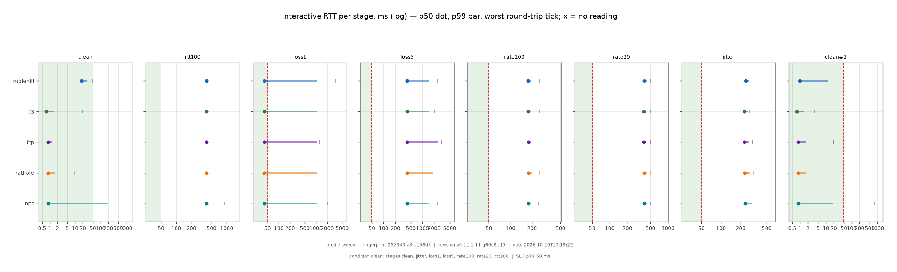

<p align="center">
  
</p>

<h1 align="center">molehill</h1>

<p align="center">
  <a href="LICENSE"></a>
  
  
  
</p>
<p align="center">
  
  
  
</p>

<p align="center">A secure, stable, high-performance reverse proxy for NAT traversal — now with transparent (L3) clients, where the device behind NAT owns its own public IP.</p>

[English](README.md) | [简体中文](README.zh.md)

molehill exposes a service on a device behind NAT to the Internet through a server with a public IP, like [frp](https://github.com/fatedier/frp) and [ngrok](https://github.com/inconshreveable/ngrok).

**Two ways to expose a service**, and the choice is the client's:

- **Forwarding (L4)** — the server binds a public port and relays connections
  into the tunnel. The usual shape, and what every tool in this space does.
- **Transparent (L3)** — the client **owns the public `ip:port` itself**. The
  server routes whole IP packets into the tunnel and the client's own kernel
  answers the visitor, so the backend sees the visitor's real source address
  and the server holds no connection state for the flow at all. This is the
  mode you want when the real source address matters — a mail server, a game
  server, anything that logs or rate-limits by peer — and it is the reason a
  reverse proxy in front of it is not a compromise. Linux and macOS clients and
  servers; Windows servers; a Windows client runs under WSL2.

<!-- TOC -->

- [molehill](#molehill)
  - [Features](#features)
  - [Benchmarks](#benchmarks)
    - [The v0.11.2 run](#the-v0112-run)
  - [Quickstart](#quickstart)
  - [Configuration](#configuration)
  - [Deployment](#deployment)
  - [Documentation](#documentation)
  - [Development](#development)

<!-- /TOC -->

## Features

- **Transparent (L3) clients: the device behind NAT owns its public IP.**
  Linux and macOS run both ends; a Windows server can serve a transparency
  claim, while a Windows client runs under WSL2. A `[transparent]` block is a
  run mode of its own: the server binds nothing, routes whole IP packets into
  the tunnel, and the **client's kernel answers the visitor** — so the backend
  sees the visitor's real source address, TCP keeps its end-to-end semantics,
  and the server holds no socket and no per-flow state for the connection.
  Nothing is translated; both IPv4 and IPv6 are carried. It lowers into the same
  engine the forwarding path uses, so the wire and the data path are shared. The daemon installs no route
  itself: on Linux it attaches to a TUN device you created; on macOS and
  Windows it creates the ephemeral device because those platforms have no
  persistent equivalent, and the operator still owns the routes, forwarding
  and firewall rules. Serving L3 is the *server operator's* decision
  (`[server.transparent]`), and without it a claim is refused by policy before
  any device is looked at. See
  [Configuration](./docs/configuration.md#transparent-l3-services) and
  [Deployment](./docs/deployment.md#transparent-services) for the recipes and
  the privileges each platform needs.
- **High throughput** — measured against frp, rathole and nps on one host with the same method; the published numbers are [below](#benchmarks).
- **Small binary** — the `minimal` profile builds a **1.84 MiB** client binary and a **2.55 MiB** embedded one (measured 2026-10-17; see the [build guide](docs/build-guide.md)).
- **Client-authoritative services** — the server needs no per-service configuration: clients declare what to expose (including the public port) and the server enforces an `allow_ports` whitelist. One shared token authenticates everything.
- **Multiplexing** — every data channel of a forwarding service rides as a yamux stream over one of a fixed pool of tunnel connections (`[client.data].tunnels`, default 4) — no per-connection handshakes, dramatically fewer file descriptors, throughput beyond a single TCP flow, and head-of-line isolation (a lost segment stalls only its own tunnel). The pool is established at service start and never resized for load (a dead tunnel is repaired); the data plane itself runs over KCP (feature `kcp`) and falls back to TCP when a KCP session cannot be established, which is what `MOLEHILL_DATA_CARRIER` forces apart for a measurement. A transparent (L3) claim is the one shape that does not multiplex — its channels *are* its carrier connections, allotted by the lane budget and lent between claims as their flows come and go (`[transparent.data].lend`) — and the `[client.data]` knobs are covered in [Configuration](./docs/configuration.md).
- **Security** — a shared token is mandatory and the `allow_ports` whitelist bounds what any client can expose. The control channel **always** speaks Noise with the fixed KK handshake: both ends know each other's static X25519 key, so a man in the middle can impersonate neither, and a plaintext control leg is refused because it would publish the credential every data channel authenticates with. Both ends refuse to start without a key pair (`molehill --genkey`). One keypair per host, no PKI and no CA. A *service* or an L3 lane may still run plain (`data_enable = false`) where the payload carries its own crypto.
- **An optional status API** — a token-gated `GET /status` on its own listener, answering what the client is carrying as JSON, so a panel or a script can read it. See [Configuration](./docs/configuration.md).
- **Hot reload** — services can be added or removed dynamically by hot-reloading the configuration file.

## Benchmarks

Single-machine comparison (`visitor -> server -> client -> backend`, all four
hops on one host), measured **through the tunnel**: the probes dial each tool's
exposed port, never the backend it forwards to. Method, chart reading and
reproduction: [Benchmarks](./docs/benchmarks.md); the decision tree behind the
settings, and the two numbers worth measuring on your own path:
[Configuration](./docs/configuration.md#choosing-your-configuration-decision-tree).

### The v0.11.2 run

Every tool is driven through the identical workload while the path follows the
stage schedule, changed in place so a session is never rebuilt. This is the
v0.11.2 sweep on one host, with the v0.11.2 binary's defaults — one multiplexed
pool of four tunnels per session, the fixed-KK Noise keypair on the control
channel (a forwarding service's data channels inherit it unless
`data_enable = false`), and dynamic striping that starts each TCP visitor at one
data channel and grows only on path backpressure. The v0.11.2 harness is a
method re-baseline, so these readings are comparable only within this method;
the comparability rule is in
[Benchmarks](./docs/benchmarks.md#comparability).


The same run as small multiples — one panel per stage, a lollipop per tool:



**Interactive stream RTT p99, per stage** (ms). Every stage after `clean` is
shaped — the harness installed the queue or the delay that dominates it — so no
winner is marked in those columns. Sample counts and the full reading rules:
[Benchmarks](./docs/benchmarks.md#how-to-read-a-cell).

| tool | clean | rtt100 | loss1 | loss5 | rate100 | rate20 | jitter | clean (repeat) |
|---|---|---|---|---|---|---|---|---|
| molehill (L4) | 30.8 | 401.3 | 1083.4 | 1463.5 | 196.2 | 433.9 | 268.5 | 11.9 |
| molehill (L3) | 1.4 | 401.4 | 1057.4 | 1451.4 | 196.1 | 419.9 | 263.9 | 1.5 |
| frp | 1.2 | 401.3 | 1064.8 | 2475.0 | 196.1 | 429.3 | 268.2 | 1.7 |
| rathole | 1.7 | 401.0 | 1058.0 | 1897.1 | 198.7 | 430.4 | 276.2 | 1.7 |
| nps | 201.2 | 415.6 | 1065.8 | 1460.7 | 196.3 | 431.5 | 301.1 | 18.3 |

**Bulk throughput per stage** (Gbit/s, over the stage's whole measured window,
not its best second).

| tool | clean | rtt100 | loss1 | loss5 | rate100 | rate20 | jitter | clean (repeat) |
|---|---|---|---|---|---|---|---|---|
| molehill (L4) | 8.641 | 3.370 | 6.950 | 1.136 | 0.094 | 0.019 | 0.019 | 7.066 |
| molehill (L3) | 5.811 | 3.164 | 4.715 | 1.036 | 0.093 | 0.019 | 0.019 | 5.830 |
| frp | 6.073 | 3.387 | 6.167 | 1.195 | 0.094 | 0.019 | 0.019 | 6.056 |
| rathole | 29.038 | 3.401 | 14.746 | 1.202 | 0.094 | 0.019 | 0.019 | 29.153 |
| nps | 0.134 | 0.136 | 0.134 | 0.136 | 0.094 | 0.019 | 0.019 | 0.134 |

**How to read it.** `molehill (L3)` is this project's second architecture, not
a fifth tool: its comparison is `molehill (L4)` and the tool-free control arm.
These are one host's v0.11.2 readings; only same-schema, same-method, same-host
runs compare directly. The stage schedule, the run's own noise floor, the
capacity ramp, the drift and cost panels, and how to reproduce a run are in
[Benchmarks](./docs/benchmarks.md).

A deployment that wants the data plane unencrypted sets
`data_enable = false` on the client or on that service and keeps the encrypted
control channel; the cost of that choice is measured at
[Benchmarks](./docs/benchmarks.md#what-each-configuration-choice-costs-per-decision-measurements).

The rest of the run's chart set: `bench-v0.11.2-capacity.png` (the load ramp),
`bench-v0.11.2-drift.png` (RSS, fds and threads over the run) and
`bench-v0.11.2-cost.png` (CPU-seconds per carried Gbit).

## Quickstart

Download a binary from the [release](https://github.com/NIyueeE/molehill/releases) page, or [build from source](docs/build-guide.md) for another platform or a smaller binary.

As with frp, all service definitions live on the client side; the server only sets policy (a shared token and the `allow_ports` whitelist).

You need a server with a public IP and a device behind NAT running the services you want to expose.

Assuming you have a NAS at home behind the NAT, and want to expose its ssh service to the Internet:

1. On the server which has a public IP

Create `server.toml` and adapt it to your needs. The control channel is always
encrypted — it carries the credential every data channel authenticates with — so
both files carry a Noise key pair. Generate one with `molehill --genkey`, keep
the **private** key here and give the **public** one to the client.

```toml
# server.toml
[server]
default_token = "use_a_secret_that_only_you_know" # Shared secret with your clients # security-scan:allow documentation placeholder

# Master switch for dynamic registrations: only ports covered here can be claimed by clients
allow_ports = ["5202"]

[server.control]
bind_addr = "0.0.0.0:2333" # Port that molehill listens for clients

# Required: the control channel is always Noise
[server.noise]
public_key = "zDdpcSQP+7Y5Mr+7UdEZMkz3gO6NGbQ1hko8/yt5knE=" # example key # security-scan:allow documentation example key
private_key = "kQiSRtS3bs8BoGCJYgFnl1FLrTG1lV53Dj8jSjmg8tE=" # example key # security-scan:allow documentation example key
```

Then run:

```bash
./molehill server.toml
```

2. On the host which is behind the NAT (your NAS)

Create `client.toml` and adapt it to your needs.

```toml
# client.toml
[client]
default_token = "use_a_secret_that_only_you_know" # Must match the server's `default_token` # security-scan:allow documentation placeholder

[client.control]
default_remote_addr = "myserver.com:2333" # The address of the server. The port must match `server.control.bind_addr`


# The server's public key, from `molehill --genkey`
[client.noise]
private_key = "8JlJQXXN0lFqz5ghIjJRq3bfRiCDKJHuXxbfu5jIxWE=" # example key # security-scan:allow documentation example key
public_key = "mEnUEACy9UrTBmwoCJb6fcKWBRdvfD9XzuBVsroOLFg=" # example key # security-scan:allow documentation example key

[client.services.my_nas_ssh]
local_addr = "127.0.0.1:22" # The local service to forward
remote_bind_addr = "0.0.0.0:5202" # The public port to expose it at on the server
```

At startup the client registers `my_nas_ssh` on the server, which validates
the port against `allow_ports` and starts forwarding. Adding or removing
services in `client.toml` applies live via hot reload — no server-side edit
needed.

Then run:

```bash
./molehill client.toml
```

3. The client connects to `myserver.com:2333`; traffic to `myserver.com:5202` is forwarded to port `22` on the NAS.

Then `ssh -p 5202 myserver.com` reaches the NAS.

To run `molehill` as a background service, see the
[systemd units](./docs/deployment.md#systemd) or
[container deployments](./docs/deployment.md#container).

## Configuration

`molehill` determines the running mode — server, client or transparent — from
the config file, or you can force it with `--server` / `--client` /
`--transparent`. The full configuration specification, logging and tuning
options are in [Configuration](./docs/configuration.md); ready-to-run examples
are in [Deployment](./docs/deployment.md#worked-examples).

## Deployment

The same binary runs on both ends; the mode comes from the config file:

```bash
./molehill server.toml   # on the public server
./molehill client.toml   # on the device behind NAT
```

Ready-to-run configuration examples, systemd units and container recipes are
in [Deployment](./docs/deployment.md), which also covers the network
requirements and the deployment security notes.

## Documentation

For people running molehill:

- [Configuration](./docs/configuration.md) — full configuration specification, logging, tuning
- [Deployment](./docs/deployment.md) — ready-to-run configs, systemd units and container recipes
- [Transport](./docs/transport.md) — Noise Protocol setup
- [Benchmarks](./docs/benchmarks.md) — how the published numbers are produced, how to read them, how to reproduce them

For people changing it (contributor and governance docs are English-only by
decision — see [AGENTS.md](./AGENTS.md) §3):

- [Checks](./docs/checks.md) — what every gate runs, how to handle a block
- [Lint policy](./docs/lint-policy.md) — lint levels and waiver rules
- [Release](./docs/release.md) — release mechanics, versioning, test builds
- [Structure](./docs/structure.md) — what every file in this repo is for
- [Build guide](./docs/build-guide.md) — build customization, minimal binary
- [Internals](./docs/internals.md) — how control/data channels work
- [Contributing](./CONTRIBUTING.md) — setup and workflow
- [Security](./SECURITY.md) — reporting vulnerabilities
- [`HANDOFF.md`](./HANDOFF.md) — current working state; planned work and future design documents

## Development

molehill is written in Rust (2024 edition); `rust-toolchain.toml` declares
`channel = "stable"` with clippy and rustfmt components — never hardcode a
version. What each gate runs, and how to handle a block, is in
[Checks](./docs/checks.md).

```bash
just setup   # activate git hooks (core.hooksPath githooks) + install check tools
just check   # fmt / secrets / machete / docs / ruff (check + format) / clippy + audit / deny / outdated / test
just tag     # release review (githooks/pre-tag) + create the local v* tag
```

molehill is an independent project that began as a fork of
[rathole](https://github.com/rapiz1/rathole); see
[CHANGELOG.md](./CHANGELOG.md) for what each release changed and
[AGENTS.md](./AGENTS.md) for the repository rules.
