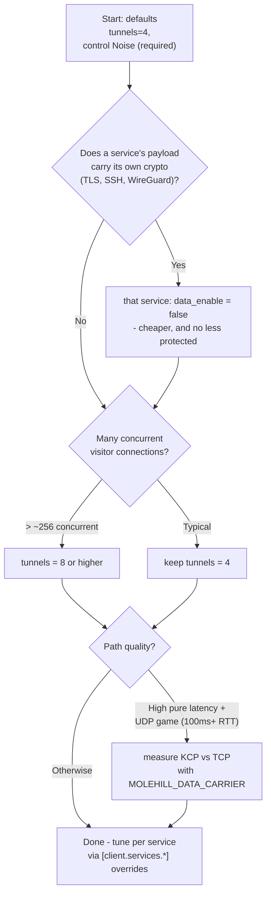

# Configuration

`molehill` picks its run mode from the configuration file: at least one of
`[server]`, `[client]` or `[transparent]` must be present, as in the
[Quickstart](../README.md#quickstart). A file may carry more than one block,
but then the mode must be chosen with `--server` / `--client` /
`--transparent`; without a flag the process refuses to guess. A host that wants
two roles runs two processes.

Ready-to-run configurations, systemd units and container deployments live
in [Deployment & examples](./deployment.md).

See [Transport](./transport.md) for the Noise keypairs and the data-encryption switch.

Page index:

- [How to configure](#how-to-configure)
- [Choosing your configuration (decision tree)](#choosing-your-configuration-decision-tree)
- [Dynamic service registration](#dynamic-service-registration)
- [Multiplexing (`multiplex` feature)](#multiplexing-multiplex-feature)
- [Transparent (L3) services](#transparent-l3-services)
- [Logging](#logging)
- [Tuning](#tuning)
- [Examples & deployment](#examples--deployment)
- [Usage notes](#usage-notes)
- [Troubleshooting](#troubleshooting)

## How to configure

The **client owns the service definitions** and the server owns only the
policy:

- The client declares each forwarded service in its own config — including
  the public address it should be exposed at (`remote_bind_addr`).
- The server has **no** per-service configuration. When a client connects, it
  registers its services at runtime; the server validates every registration
  against its `allow_ports` whitelist before exposing anything.
- Both sides authenticate with one shared secret (`default_token`).

A process runs in exactly **one** of three modes, and the file says which:
`[server]`, `[client]` (forwarding) or `[transparent]` (L3 — see
[Transparent (L3) services](#transparent-l3-services)). A mode is a property of
the *process* — its capabilities, its sockets, its TUN device — so a file
carrying two blocks needs a flag to pick one, and a host that wants two roles
runs two processes. `--server` / `--client` / `--transparent` override what the
file says.

A typical setup:

1. Generate one X25519 keypair per host with `molehill --genkey` (see [Transport](./transport.md)).
2. Write `server.toml`: `[server]` with `default_token` and the `allow_ports` whitelist, plus `[server.control].bind_addr`. That's all.
3. Write `client.toml`: `[client]` with the same `default_token`, `[client.control].default_remote_addr`, and one `[client.services.<name>]` block per service: `local_addr` (where your service listens) and `remote_bind_addr` (the public endpoint).
4. Start the server first, then the client. Both run indefinitely; the client retries automatically while the server is unreachable.

> **Migrating from ≤0.6**: delete the whole `[server.services.*]` section; move each service's `bind_addr` into the client's `remote_bind_addr`; replace per-service tokens with `default_token`; add `allow_ports` on the server. Both ends must be upgraded together (the protocol version changed).

> **Migrating from 0.7.x**: the client keys moved into dedicated blocks and
> the data plane gained an explicit endpoint. Old → new:
> `[client].remote_addr` → `[client.control].default_remote_addr`;
> `[client].heartbeat_timeout` / `retry_interval` →
> `[client.control].default_*`;
> `[client].mux = false` → `[client.data].default_mode = "direct"`;
> `[client].mux = true` → `[client.data].default_mode = "multiplex"` — and
> `default_mode` was itself removed afterwards, because the shape is derived
> from the service type now (see "Migrating: the data plane's shape is no
> longer a key") (the
> `mux_receive_window` / `mux_max_streams` knobs are gone — fixed internal
> yamux defaults now);
> `[client.transport].type = "tcp"` → `"plain"`;
> `[client.transport.tcp].proxy` → `[client.transport].proxy`;
> `[client.transport.tcp].nodelay` / `keepalive_secs` / `keepalive_interval`
> were removed (fixed internal defaults). The per-service `nodelay` key is removed in 0.11.2: TCP_NODELAY is always on.
> the `tls` and `websocket` transport values were removed in 0.8: only
> `"plain"` and `"noise"` remain, and the `[client.transport.tls]` /
> `[client.transport.websocket]` / `[server.transport.tls]` /
> `[server.transport.websocket]` blocks are gone (migrate to `noise`);
> `[server].bind_addr` → `[server.control].bind_addr` (a separate
> data-plane listener is optional via `[server.data].bind_addr`, defaulting
> to the control listener);
> `[server].heartbeat_interval` → `[server.control].heartbeat_interval`.
> The 0.8 client-side blocks use `default_`-prefixed names for the
> client-wide defaults — `[client.control]` (`default_remote_addr`,
> `default_heartbeat_timeout`, `default_retry_interval`) and `[client.data]`
> (`default_data_addr`, `tunnels`) — so they read
> distinctly from the per-service overlay keys on
> `[client.services.<name>]` (`protocol`, `remote_addr`, `token`,
> `retry_interval`, `transport` (both removed in 0.11.2), `max_udp_workers`,
> `udp_forwarder_ipv6`, `udp_send_queue_size`, ...; new in 0.8).
> The 0.8 `[client.transport]` table was replaced in 0.11.2 by `[client.noise]` (see the 0.11.2 migration above).
> The per-service key is `[client.services.<name>.noise]`.
> collision at the service level (the `default_` prefix exists to
> disambiguate exactly that).
> Old keys are rejected (`deny_unknown_fields`), never silently ignored.
>
> **0.8 protocol**: every connection starts with a one-byte transport
> selector (`0x00` plain / `0x01` noise) and the registration carries the
> data-plane carrier — both ends must upgrade together; a version mismatch
> is a hard error.
>
> **Upgrading to 0.10 (protocol v4)**: the client speaks v4 — one control
> session per endpoint, carrying every service that dials it, with the server
> naming a stripe group before its channels are opened — and 0.10.0 is the
> first release that serves **v4 only**: a v3 client's connection is
> refused on the connection it happens on, with nothing sent back. Upgrade
> both ends together, then; either order works, because each side refuses the
> other's dialect instead of continuing, and the refused connection names the
> version that was expected.
>
> **Upgrading to 0.11.0 (protocol v5.0)**: the wire carries transparent (L3)
> services, so it is v5.0, and 0.11.0 serves **v5.0 only** — a 0.10 peer's
> connection is refused on that connection alone, with nothing sent back, and
> the same is true in the other direction. Upgrade both ends together; either
> order works, and each side says which version it expects.
>
> **Upgrading to 0.11.1 (protocol v5.1)**: v5.1 is a wire break, not a
> compatible patch: the hello carries a two-byte version and a transparent data
> channel negotiates its frame format. A 0.11.0 peer (v5.0) is refused on the
> connection it happens on, in both directions. Upgrade both ends together;
> there is no mixed-version deployment.
>
> **Upgrading to 0.11.2 (protocol v5.2)**: the wire is v5.2. `StartForwardTcp` is gone — every TCP data channel is a stripe group, starting at one data channel and growing under backpressure — and the registration carries `max_udp_workers`. A 0.11.1 (v5.1) peer is refused on the connection it happens on; upgrade both ends together.
> **Upgrading to 0.11.2 (flat Noise tables)**: the handshake is fixed KK and
> the wire tables are flat. Replace `[client.transport]` / `[client.transport.noise]`
> with `[client.noise]`, `[server.transport.noise]` with `[server.noise]`, and
> `[transparent.transport.noise]` with `[transparent.noise]`; rename
> `local_private_key` to `private_key` and `remote_public_key` to
> `public_key`. KK needs both sides' keys, so the server adds the client's
> public key and the client adds its own private key (one `molehill --genkey`
> per host). `type = "noise"` becomes the absent `data_enable` (default true),
> and `type = "plain"` becomes `data_enable = false`. `pattern`, `psk`,
> `psk_location`, `resume` and `proxy` have no replacement. See
> [Transport](./transport.md#migrating).

### Migrating to 0.10: removed keys

The tunnel pool is one per-carrier pool per session, pinned at the count its
configuration names — so the keys that described a pool's *initial* size, a
per-service pool, or a late-0.8 health check are gone. A config that still carries one does not
start: the refusal names every key it found and what to write instead (a bare
"unknown field" tells you *that* something is wrong without telling you what to
write). Write this instead:

| Removed key | Write instead |
|---|---|
| `[client.data].default_count` | Nothing: the pool's width is `[client.data].tunnels`, default 4 |
| `[client.services.<name>].count` | Nothing: the pool belongs to the session rather than to one service. `[client.data].tunnels` (or the service's own) is its width |
| `[client.services.<name>].pool_size` | `[client.services.<name>].max_udp_workers` for a UDP service (default 2). A TCP service opens one data channel per visitor, on demand |
| `[client.services.<name>].heartbeat_timeout` | Nothing: the server declares its cadence in the session ack and the client derives the timeout from it. `[client.control].default_heartbeat_timeout` remains as an optional floor |
| `[server].max_pool_size` | `[server.data].max_tunnels` (the server-wide cap on live tunnels and lanes; unset = open-file-derived, 0 = unlimited) |
| `[client.services.<name>].health_check` | Nothing: a service stays registered for as long as its client runs; a request that cannot be forwarded fails for that visitor |

The next section states what each of the replacements does and what it costs;
[CHANGELOG.md](../CHANGELOG.md) records why the removals happened.

### Migrating: the data plane's shape is no longer a key

`mode` is gone. A config that still carries `[client.data].default_mode` or a
per-service `[client.services.<name>].mode` does not start: the refusal names
the key and what to do. What the key used to express is a property of the
service type now:

| Removed key | Write instead |
|---|---|
| `[client.data].default_mode` | Nothing: a forwarding service always multiplexes. `[client.data].tunnels` is how wide its pool is |
| `[client.services.<name>].mode` | Nothing: the shape follows the protocol — a forwarding service multiplexes, a transparent claim never does |

A claim's channels *are* its carrier connections — a claim's throughput is the
sum of connections rather than of streams — so multiplexing one is framing for
nothing: on the same host and workload the same claim on its own connection
moved 6 % fewer wire bytes, took 33 % less CPU per packet and carried 65 % more
round trips per second
([Benchmarks](./benchmarks.md#the-transparent-l3-wire-question-the-acceptance-harness)).

### Migrating to 0.11: the carrier and the pool's clock

Which carrier works is a property of the network, not of the deployment, so the
data plane chooses it at runtime (KCP first, falling back to TCP) and the keys
that used to state it are gone. The pool is **pinned** too — it is established
at service start and repaired, never grown on load or reaped for idleness — so
there is no shrink clock to configure:

| Removed key | Write instead |
|---|---|
| `[client.data].default_carrier` | Nothing: the data plane dials KCP and falls back to TCP when a session cannot be established. `MOLEHILL_DATA_CARRIER=tcp\|kcp` forces one apart, for a measurement or a test that needs the two paths separated |
| `[client.services.<name>].carrier` | Nothing — the same reason. A service's own `tunnels` is the data-plane key it may still write |
| `[client.data.tcp]` | `[client.data].tunnels`: one pool and one width, whichever carrier it rides |
| `[client.data.kcp]` | `[client.data].tunnels` — the same |
| `[client.data].idle_timeout` | Nothing: a pinned pool is never reaped for idleness, so there is no timeout to set |

### Migrating to 0.11.2: one pool per session

A forwarding client holds one tunnel pool for its whole control session now, so
the keys that described a per-service width or a pool-ownership switch are
gone:

| Removed key | Write instead |
|---|---|
| `[client.services.<name>].tunnels` | `[client.data].tunnels`: it is the session's total width, and every service of the session draws on it |
| `[client.data].shared_pool` | Nothing: one pool per session is the only shape. Its width is `[client.data].tunnels` |
| `[client.services.<name>].nodelay` | Nothing: every forwarded connection has TCP_NODELAY on |
| `[client.services.<name>].udp_workers` | `[client.services.<name>].max_udp_workers`: the ceiling on the worker set, not the count it starts with |
| `[client.services.<name>].udp_send_queue_size` | Nothing: the queue is internal and uses CoDel |
| `[client.services.<name>].udp_idle_timeout` | Nothing: a peer mapping's lifetime follows the peer's own traffic |
| `[client.services.<name>].udp_forwarder_ipv6` | Nothing: the forwarder follows the address family of `local_addr` |
| `[client.control].default_retry_interval` | `[client.control].retry_backoff_max`: the key names the retry cap; unset means the adaptive 1-60 s default |
| `[client.services.<name>].retry_interval` | `[client.services.<name>].retry_backoff_max`: unset inherits `[client.control].retry_backoff_max` |
| `[transparent.control].default_retry_interval` | `[transparent.control].retry_backoff_max`: the same cap, for the L3 client |
| `[transparent.claims.<name>].retry_interval` | `[transparent.claims.<name>].retry_backoff_max`: unset inherits `[transparent.control].retry_backoff_max` |
| `[transparent.claims.<name>].tunnels` | `[transparent.data].tunnels`: a claim's lane count is its share of the client's budget |
| `[server.data].max_tunnels_per_client` | `[server.data].max_tunnels`: the valve is global now; unset derives it from the open-file limit and 0 is unlimited |
| `[server.data].stripe_count` | Nothing: striping starts at one channel per visitor and grows under backpressure |

## Choosing your configuration (decision tree)

The first choice is the mode: `[client]` forwards to a local application,
`[transparent]` owns public addresses instead (see
[Transparent (L3) services](#transparent-l3-services)) — and it is a choice
about the process, not about a service, so it comes before anything below.

The defaults — a pinned pool of `tunnels = 4` multiplexed connections, a Noise
control channel (required), and a data plane that tries KCP before falling back
to TCP — are the right starting point for almost everyone. Deviate only when the tree says so, change one thing at a time, and
measure the result on your own path: the published runs, their numbers and how
to reproduce them are
in [Benchmarks](benchmarks.md). This page owns **what each setting does**.



### What each choice costs (what you trade)

| Decision | Option | What you give up / gain |
|---|---|---|
| `tunnels` | `1` | one tunnel for everything: no aggregation across flows, and one loss event stalls every stream sharing the retransmit domain. Measured as the worst configuration on every path |
| `tunnels` | `4` (default) | aggregates beyond a single flow and isolates head-of-line blocking between tunnels; `4 × 64` concurrent connections |
| `tunnels` | `8+` | more parallel tunnels (more NAT mappings) and a proportionally higher connection ceiling; measured worth +77 % throughput from one tunnel to eight on a clean fast path |
| carrier | (no key) | the data plane dials KCP and falls back to TCP when a session cannot be established, because which one works is a property of the network and not of the deployment. `MOLEHILL_DATA_CARRIER` forces one apart for a measurement. Measured, TCP is ahead in every unflagged cell and KCP's one win is UDP session quality at 100 ms RTT ([Benchmarks](benchmarks.md#what-each-configuration-choice-costs-per-decision-measurements)) |
| `data_enable` | `false` | data channels are plain; lowest per-byte cost. The control channel stays KK |
| `data_enable` | `true` (default) | every data and lane channel is wrapped in KK, at a small CPU cost and no extra round trip |
| pool establishment | (no key) | the pool's `tunnels` connections are dialed at service start, not on the first visitor: nothing is paid at request time, and the cost is `tunnels` idle connections (measured at 0.5–0.8 MiB RSS and 2.6 FDs each, no threads) |
| `max_udp_workers` | 2 (default) | UDP only: the ceiling on the service's worker set. It starts one data channel and grows only when the server asks (queue pressure), then retires an idle worker; distinct visitors shard across the live workers and one visitor is never split across channels. It does not raise the datagram ceiling, whose measurement is in [Benchmarks](benchmarks.md#the-udp-queue-question-a-molehill-only-diagnostic) |

The measured cost of each option — including the figures these trade-offs come
from, and their provenance — is in [Benchmarks](benchmarks.md#what-each-configuration-choice-costs-per-decision-measurements).

**Validate the choice** with the exposure you care about: `ping` / in-game
feel for latency, `iperf3` on the exposed port for raw throughput, and the
real traffic of your service. To compare two configurations or two builds on
your own hardware, [Benchmarks](benchmarks.md#reproduce-it-yourself) has the
commands.

Here is the full configuration specification:

```toml
[client]
default_token = "change-me" # Necessary. Must match `[server].default_token`

[client.control]
default_remote_addr = "example.com:2333" # Necessary. The address of the server
# default_heartbeat_timeout = 65 # Optional. Application-layer heartbeat timeout. Unset (the default) derives it from the cadence the server declares in the session ack: `max(10 s, 2 × server.control.heartbeat_interval + 5 s)`. A value below that floor is refused at startup (it would time out a healthy server); 0 disables the check
retry_backoff_max = 30 # Optional. Cap of the reconnect backoff, not a fixed interval: the delay grows by a factor of 3 with jitter and is capped at this value (jitter can make one sleep up to twice the cap). Unset = adaptive: 1, 2, 4, 8, 16, 32, then 60 s as consecutive failures grow. Set a value to pin the cap for every outage

[client.data]
# default_data_addr = "example.com:2343" # Optional. Data-plane endpoint; defaults to the service's control endpoint (`client.services.<name>.remote_addr` when set, else `client.control.default_remote_addr`). The KCP sessions dial that address over UDP, so a TCP control channel and the KCP data plane can share one port (distinct protocols)
# tunnels = 4 # Optional. The session's single pool width: how many carrier connections the client holds for every service it carries. Default: 4. Must be `>= 1`; values above 64 are clamped
# The carrier is deliberately **not** a key here: the data plane tries KCP (feature `kcp`) and falls back to TCP when a session cannot be established, because which one works is a property of the network and not of the deployment. A transparent claim goes further and moves a lane *while it runs*: each lane is measured (what the server offered it, what that lane's queue refused there, what the client injected off it), and a lane whose carrier is refusing a material share of what it is offered is handed over to the other one — the peer stops placing new flows in it, and it is retired once both ends agree it holds nothing, so a running flow finishes where it is and nothing is reordered. `MOLEHILL_DATA_CARRIER=tcp|kcp` forces one, for a measurement or a test that needs the paths apart — it also disables the fallback and the automatic move


[client.noise]

private_key = "8JlJQXXN0lFqz5ghIjJRq3bfRiCDKJHuXxbfu5jIxWE=" # Necessary. The client private key, base64 32 bytes
public_key = "mEnUEACy9UrTBmwoCJb6fcKWBRdvfD9XzuBVsroOLFg=" # Necessary. The server public key, base64 32 bytes; the handshake is fixed KK
data_enable = true # Optional. Encrypt this client data channels (tunnels and lanes). Default: true; the control channel is always Noise

[client.services.service1]
protocol = "tcp" # Optional. The protocol that needs forwarding. Possible values: ["tcp", "udp"]. Default: "tcp". A service that must own its public ip:port instead is not a forwarding service at all: it belongs to a `[transparent]` block, which is its own run mode — see "Transparent (L3) services" below
local_addr = "127.0.0.1:1081" # Necessary. The address of the local service that needs to be forwarded
remote_bind_addr = "0.0.0.0:8081" # Necessary. The public address this service is exposed at on the server. Must be covered by the server's `allow_ports`
retry_backoff_max = 30 # Optional. This service's cap of the reconnect backoff, with the same semantics as `client.control.retry_backoff_max`. Default: inherits `client.control.retry_backoff_max`, then the adaptive default
token = "service-specific-token" # Optional. Override `client.default_token` for this service only — e.g. to authenticate against a server that has its own token # security-scan:allow documentation placeholder
remote_addr = "server2.example.com:2333" # Optional. Override `client.control.default_remote_addr` for this service only — its control channel (and, by default, its data plane) dials this server. Lets one client spread services across several molehill servers
# [client.services.service1.noise] # Optional. Per-service KK overrides: public_key and private_key (to dial another server with its own pair) and data_enable (to make this service data channels plain). Unset fields inherit [client.noise]

[client.services.service2]
protocol = "udp"
local_addr = "127.0.0.1:1082"
remote_bind_addr = "0.0.0.0:8082"
max_udp_workers = 2 # Optional. UDP services only: the ceiling on this service's worker set (1..=64). The client starts one data channel and opens another only when the server asks, up to this value; idle workers retire. Default: 2
udp_buffer_size = 2048 # Optional. UDP receive buffer in bytes. Default: 2048, maximum 65535

[server]
default_token = "change-me" # Necessary. Must match `[client].default_token`
allow_ports = ["6000-6999", "8080"] # Necessary to enable dynamic registration. Empty or missing: ALL registrations are rejected. A requested port is admitted when one of these entries contains it — a literal port, or a range covering it, privileged ports (<1024) included

[server.control]
bind_addr = "0.0.0.0:2333" # Necessary. The address that the server listens for clients. Generally only the port needs to be changed
heartbeat_interval = 30 # Optional. The interval between two application-layer heartbeats. Unset = adaptive: 30 s up to 8 sessions, 60 s up to 32, 120 s above. Set to 0 to disable heartbeats

[server.data]
# bind_addr = "0.0.0.0:2343" # Optional. Data-plane listener; defaults to `server.control.bind_addr`. The KCP UDP listener binds here too on the first `kcp` registration — with the default address, TCP control and UDP KCP coexist on one port (distinct protocols)
# max_tunnels = 0 # Optional. The server-wide valve on live carrier connections: every multiplexed tunnel and every transparent lane of every client counts against it. Unset derives the cap from the process's open-file limit; 0 is unlimited. A connection over the cap is refused with a typed answer naming it, and the session keeps running

[server.noise]
private_key = "kQiSRtS3bs8BoGCJYgFnl1FLrTG1lV53Dj8jSjmg8tE=" # Necessary. This server private key, base64 32 bytes
public_key = "zDdpcSQP+7Y5Mr+7UdEZMkz3gO6NGbQ1hko8/yt5knE=" # Necessary. The client public key, base64 32 bytes; the handshake is fixed KK

[server.transparent]
tun = "molehill0" # Optional. The server's TUN device. Default: molehill0 on Linux and Windows, auto (a free utunN) on macOS. Linux: the operator creates it and routes every claim into it. macOS/Windows: the daemon creates it; the operator routes/forwards
```

## Dynamic service registration

There are no `[server.services.*]` blocks anymore. The lifecycle is:

1. The client authenticates with `default_token`.
2. For each configured service the client sends a `RegisterService` message:
   name, `protocol` (tcp/udp/transparent), `remote_bind_addr`, the data-plane
   `carrier` it will use (tcp/kcp — a `kcp` carrier triggers the server's lazy
   UDP listener) and the UDP buffer size. The channel count is not part of the
   message: the client opens the channels it configured (one per visitor for
   TCP, `max_udp_workers` for UDP, the carrier's lane share — long-lived connections
   — for a transparent claim) and the server asks for another when a visitor
   arrives or a channel ends.
3. The server validates:
   - **whitelist**: the requested port must be covered by `allow_ports`;
     an empty/missing `allow_ports` rejects *every* registration (this is
     how you disable the feature entirely);
   - **privileged ports**: there is no separate rule — a whitelist entry
     (literal or range) admits the ports below 1024 inside it like any
     other port. Binding one still fails unless the server has the OS
     privilege (root, or a lowered
     `net.ipv4.ip_unprivileged_port_start`), so when the server is
     privileged, list the privileged ports it should expose literally;
   - **conflicts**: if the port is already bound, the registration fails
     with `Port already in use`.
4. On success the server binds the port immediately and starts forwarding.

Rejections are permanent for that service run: the client logs the exact
reason from the server and gives up until you fix the configuration or
restart it. Service names must be unique per server; re-registration from a
restarting client takes over cleanly.

## Multiplexing (`multiplex` feature)

The `multiplex` feature is part of the default feature set. A registered
forwarding service runs over a **fixed pool of tunnel connections**
(`[client.data].tunnels`, default 4), and every data channel it carries
becomes a yamux stream inside one of them. This removes the per-connection
handshake latency (TCP connect plus, with `noise`, the Noise handshake) and cuts
FD usage under many concurrent visitors. The shape is not a key: a forwarding
service always multiplexes (there is no `mode` to write), and a
[transparent claim](#transparent-l3-services) never does.

- The decision belongs to the client alone; the server adapts per connection
  automatically.
- Per-tunnel buffering is bounded by internal defaults (32 MiB yamux receive
  window, 64 streams) — bounded loss backlog without throughput loss; the
  values are fixed because yamux couples them (see internals.md).
- **The pool is established at service start and pinned.** All `tunnels`
  connections are dialed when the service activates, so the first visitor pays
  nothing (the setup cost is paid before it arrives) and the capacity a
  deployment offers does not depend on what it happened to be doing a minute
  ago. The pool is never resized for load, and idle tunnels are never reaped.
- **Repair is the one exception**, and it is not growth: a tunnel that dies is
  replaced until the count is met again, so a single failure cannot shrink a
  deployment permanently. What is *not* repaired is the count itself — a pool
  that needs to be wider needs `tunnels` raised and the client restarted, which
  is the point: capacity is a configuration decision, not a runtime one.
- `tunnels = N` is how many carrier connections that carrier's pool holds.
  Independent TCP flows isolate head-of-line blocking (a lost segment stalls
  only its own tunnel) and aggregate beyond a single flow's congestion window.
  If a tunnel dies, opens transparently fall through to the survivors and the
  repair tick dials a replacement. Default: 4
  count when that is larger); `1` reproduces single-tunnel behavior at a
  measured cost — one tunnel was the worst configuration on every path in the
  model's cells, because every stream then shares one congestion window.
- **What happens when the load exceeds the pool** is sharing, not growth: the
  streams spread over the tunnels that exist, up to 56 per tunnel, and a
  visitor that arrives when every tunnel is at that ceiling waits briefly for a
  stream to retire and is refused if none does. Size `tunnels` for the
  concurrency you expect; the measurements behind the sizing are in
  [Benchmarks](benchmarks.md#what-each-configuration-choice-costs-per-decision-measurements).
- **The carrier is not a choice you write.** The data plane dials KCP
  (feature `kcp`, in the default set) and falls back to TCP when a session
  cannot be established, because which of the two works is a property of the
  network between the two ends: UDP may be blocked, shaped, or fine today and
  blocked tomorrow. A fallback is announced once at `INFO`, is re-probed every
  60 s, and never changes how packets are carried once a pool or a lane is up.
  To *measure* the two paths apart — or to reproduce a test that needs TCP —
  `MOLEHILL_DATA_CARRIER=tcp|kcp` forces one and disables the fallback; the
  comparison itself is in
  [Benchmarks](benchmarks.md#what-each-configuration-choice-costs-per-decision-measurements).
  The crypto stack is unchanged — with
  data encryption on, the same Noise handshake wraps each KCP session — and
  yamux still carries the data channels, so `tunnels` applies as usual. The
  server opens its UDP listener lazily — the first registration that
  declares the `kcp` carrier triggers the bind, and a bind failure is a
  precise registration rejection; servers whose clients never use KCP never
  open the UDP socket. The listener binds on the data address
  (`[server.data].bind_addr`, default = the control address) and each
  session authenticates with the control session's nonce exactly like a TCP
  tunnel. If neither side sets a data
  address, **TCP control and UDP KCP share one port number**: TCP and UDP
  are distinct protocols, so both sockets bind the same port without
  conflict (remember to open both protocols in the firewall/NAT). Fixed KCP
  parameters (recorded
  for comparability): stream mode, nodelay 10 ms interval, fast-resend 2,
  congestion control off, snd window 8192 / rcv window 4096 segments
  (the send window is the throughput ceiling on a lossy path: 2048 carried
  533 Mbit/s at the ~44 ms round trip such a path settles at, and 8192 with
  the peer's 4096-segment window as the cap both removes that ceiling and
  leaves a clean path's numbers where they were),
  **datagram size follows the path** (1400 bytes — what any path carries —
  up to 8 KiB where the path's own MTU allows it; the kernel's path-MTU
  answer is re-read once a second, so a session on a 1500-byte path never
  sends a datagram that would have to be fragmented), 32 MiB socket
  buffers. Keepalive: a 2 s adapter-level PING/PONG
  keeps idle tunnels warm (NAT mappings) and probes the path RTT; a
  vanished peer is only confirmed on the next write: a session ends when a
  segment has been retransmitted ~20 times **and** the send window has stood
  still for five seconds, so a peer that is merely slow — acknowledgements
  queued behind a shaper, say — is not mistaken for one that is gone.
- Building without the feature removes the option entirely, and such a
  build must not see the corresponding tables at all: a config that
  contains `[client.data]` or `[server.data]` is rejected there (unknown
  keys — `deny_unknown_fields`). Delete those tables and every data channel is
  a connection of its own.

**Binding the data plane separately.** By default both planes share the
control address. To put the data plane on its own port, set both sides:

```toml
# server.toml
[server]
default_token = "change-me"
allow_ports = ["5202"]

[server.control]
bind_addr = "0.0.0.0:2333"

[server.data]
bind_addr = "0.0.0.0:2343"

[server.noise]
public_key = "zDdpcSQP+7Y5Mr+7UdEZMkz3gO6NGbQ1hko8/yt5knE=" # Necessary. The client public key, base64 32 bytes; the handshake is fixed KK
private_key = "kQiSRtS3bs8BoGCJYgFnl1FLrTG1lV53Dj8jSjmg8tE=" # Necessary. This server private key, base64 32 bytes
```

```toml
# client.toml
[client]
default_token = "change-me"

[client.control]
default_remote_addr = "server.example.com:2333"


[client.noise]

private_key = "8JlJQXXN0lFqz5ghIjJRq3bfRiCDKJHuXxbfu5jIxWE=" # Necessary. The client private key, base64 32 bytes
public_key = "mEnUEACy9UrTBmwoCJb6fcKWBRdvfD9XzuBVsroOLFg=" # Necessary. The server public key, base64 32 bytes; the handshake is fixed KK
data_enable = true # Optional. Encrypt this client data channels (tunnels and lanes). Default: true; the control channel is always Noise

[client.data]
default_data_addr = "server.example.com:2343"

[client.services.echo]
local_addr = "127.0.0.1:8080"
remote_bind_addr = "0.0.0.0:5202"
```

The server binds a second TCP listener on `[server.data].bind_addr` and opens
the KCP UDP socket there on the first KCP registration; open **both** TCP and
UDP on that port. A service with its own `remote_addr` follows that server for
both planes, so the client-wide `default_data_addr` does not apply to it.

**Per-service overrides.** `[client.data]` holds the defaults; each service can
override `tunnels` individually on its own `[client.services.<name>]` block, and
nothing else about the data plane: the carrier follows the path and the shape
follows the protocol. So one client can give a busy service a wider pool than the
rest, or share one pool between two services, without any server configuration
change: the server adapts per connection and opens its KCP listener on the first
registration that declares it (there
is no per-carrier server configuration). The same overlay pattern covers the
control defaults: `token` and `remote_addr` override `[client].default_token` and
`[client.control].default_remote_addr`, and `retry_backoff_max` overrides
`the control-wide cap`. A service's heartbeat is not a per-service knob: one
session carries one timer, derived from the cadence the server declares (see
`[client.control].default_heartbeat_timeout`). `default_data_addr` itself
cannot be overridden per service — the data-plane endpoint follows the
service's own server when it has one (see below).

**Multiple servers.** A service can also override the server itself:
`[client.services.<name>].remote_addr` replaces
`[client.control].default_remote_addr` for that service's control channel,
and its data plane follows by default (tunnels dial the same endpoint,
since the server's data listener defaults to its control address). One
client can therefore spread its services across several molehill servers —
a nearby replica per region, separate servers per tenant, or a migration
window while moving services one by one. Every server must authenticate
the service with a token: a service can carry its own `token` for a server
that does not share the client's `default_token`; each server's `allow_ports`
must cover the services registered on it, and the client derives each
session's heartbeat timeout from the cadence that server declares, so servers
with different cadences coexist. The
data-plane endpoint chain is: the service's own `remote_addr`, else
`[client.data].default_data_addr`, else `[client.control].default_remote_addr`
— so a global `default_data_addr` applies only to services without their own
`remote_addr`, and a server that runs its data listener on a separate port
(a distinct `[server.data].bind_addr`) needs that address set globally,
which then applies to every service that follows the client-wide endpoint.

The wire-level design — tunnel upgrade, per-stream framing and windows, and
why pooled streams need a SYN kick — is in [Internals](./internals.md).

## Transparent (L3) services

A transparent (L3) client gives the **client** the public `ip:port` instead of
having the server bind it. The client's host carries the claimed address on a
TUN device, the server routes whole IP packets into the tunnel, and the client's
own kernel answers the visitor — so the backend sees the visitor's real source
address, TCP keeps its end-to-end semantics, and the server holds no socket and
no per-flow state for the connection.

It is **its own run mode, with its own model**: a `[transparent]` block, started
with `molehill <config> --transparent` (or on its own, since the block says what
the process is). Every service it has is a **claim** on a public address, so
there is no `protocol` key to switch an entry's meaning and the keys a
forwarding service would use have no home in the schema at all: `local_addr`,
`nodelay` and the UDP-only keys cannot be written, rather than being written and
refused. A `[client.services.<name>]` entry with `protocol = "transparent"` is
refused with a message pointing here, and a file carrying both a `[client]` and
a `[transparent]` block is refused too — a host that both forwards and claims
runs **two processes**, which is also what keeps `CAP_NET_ADMIN` off the one
that does not need it.

It runs on **Linux and macOS**, and a **Linux, macOS or Windows server** can
serve it. Windows **cannot be a client**: its stack has no source-address
policy routing, so an application's replies would not return to the tunnel; a
Windows client config is refused at parse time with the WSL2 guidance. The
`transparent` feature is part of the default set. A config that asks for a
client on an unsupported platform, or in a build without the feature, is
refused at parse time with the reason and the supported alternative.

The device lifecycle follows the platform. On Linux the operator creates a
persistent TUN device and the daemon attaches to it; the process needs
`CAP_NET_ADMIN`. On macOS the daemon creates an ephemeral `utunN`, assigns each
claimed address (`/32` or `/128`) to it, and the operator owns the pf rule and
routes; the process needs root. On Windows the daemon creates a Wintun adapter,
and the operator owns the route, forwarding and firewall rules; the process
needs Administrator and `wintun.dll` beside the binary. Both IPv4 and IPv6 are
carried: the parser understands the IPv6 base header, the common
extension-header chain (including fragments), and TCP/UDP ports; ICMPv6 and ESP
are routed by address alone. IPv6 jumbograms are rejected as malformed, and a
transport header behind an extension this parser does not understand is routed
address-only. A packet whose version is neither 4 nor 6 is dropped and counted.

**Serving L3 is the server operator's decision.** On the server the
`[server.transparent]` table is the switch: without it a transparent
registration is refused by policy, before any device is looked at, so a client
can never be what makes the server open a device or ask the kernel for the
capability. A server that only forwards `tcp`/`udp` services therefore
needs no capability for this feature at all. Enabling L3 does have a
consequence worth stating plainly: such a client is never encrypted, so a
server that serves one accepts plaintext connections from it, whatever
`[server.noise]` says — the Noise keys keep applying to the clients
that do negotiate them.

**The daemon never installs a route, a rule or a firewall rule.** It has no
netlink code and never shells out to `ip`. On Linux it attaches to the
operator's persistent TUN device and verifies the addresses and `rp_filter` the
operator configured. On macOS and Windows it creates the ephemeral device
because those platforms have no operator-created equivalent; it assigns the
claimed addresses on macOS, while the operator installs the pf rule, routes and
forwarding. The recipes are in
[Deployment](./deployment.md#transparent-services).

| Key | Meaning |
|---|---|
| `[transparent]` | **the mode**: this block is what makes the process an L3 client, and it is where the client-wide half lives (`default_token`, `tun`, `control`, `data`, `noise`) |
| `[transparent.status]` | the optional read-only status API, the same shape as `[client.status]`: `bind_addr` and a non-empty `token` |
| `[transparent.claims.<name>]` | one claimed public address. The name identifies the claim (shown in logs) |
| `[transparent.claims.<name>].remote_bind_addr` | the public `ip:port` the client **claims**. Its port must be covered by the server's `allow_ports` — a claim is a registration like any other; the address has to be local on the client (the recipes assign it to the TUN device). IPv4 is written as `10.99.0.1:8443`, IPv6 as `[2001:db8::1]:8443` |
| `[transparent].tun` | the TUN device the client attaches to. Default: `molehill0` on Linux and Windows, `auto` (a free `utunN`) on macOS |
| `[transparent.data].tunnels` | the **lane budget**: how many carrier connections this client holds for all of its claims together, divided equally among the claims. One lane **is** one connection (a claim never multiplexes), and every claim keeps at least one. Default: **two lanes per claim** — a measured knee, and the trade it makes is priced in the note below this table. The division is where the lanes *start*: a claim carrying more flows than it has lanes takes an idle lane from a claim that can spare one (never its last), so the budget decides how many connections exist and the traffic decides who holds them. A budget below the claim count is refused with the number to write; the ceiling is 1024 lanes per client; a budget that is not a multiple of the claim count leaves the remainder unallocated — the allocator redistributes the shares, it does not spend what the division left over, so write a multiple when you want every lane used |
| `[server.transparent]` | **the switch**: the presence of this table is what lets the server serve L3 at all. Absent, every transparent registration is refused by policy before any device is looked at |
| `[server.transparent].tun` | the TUN device the server attaches to. Default: `molehill0` on Linux and Windows, `auto` (a free `utunN`) on macOS |

**The lane budget's default is two lanes per claim, and that is a trade, not
a preference.** A claim's data path is serialized per lane — one device reader
and one injector — so a busy claim's throughput follows its lanes, and so does
the pressure it puts on the reader every claim shares. Both axes are measured
(one host, one binary, five claims, eight inner flows):

| lanes per claim | bulk alone | with an interactive stream beside it |
|---|---|---|
| 1 | 2.351 Gbit/s | 8 streams sustained, 2.35 Gbit/s plateau |
| **2** | **3.283 (+40 %)** | **8 streams — the ramp's ceiling — 3.32 Gbit/s, p99 2 ms** |
| 4 | 5.191 (+121 %) | **3 streams**, p99 271 ms from four, 560 ms at five |
| 8 | 5.255 | — |

Four lanes buys another 58 % of *bulk* throughput and spends the interactive
stream's headroom doing it, which is why the default is two: the bulk ceiling is
reachable by writing `tunnels`, and the SLO is not something a default may
quietly break. (Measured on the pre-v0.11.0 binary; the segmentation offload
that release takes raises the bulk column's absolute values, but the *shape* —
the knee at two, the SLO cost past it — is the trade this table prices, and the
SLO column is probe-bound rather than throughput-bound, so it does not move.) It is paid for in connections — `lanes x claims` of them, each a
socket, **≈2.6 file descriptors and 0.5–0.8 MiB RSS on both ends**, plus a slot
in the server's `[server.data].max_tunnels` global valve (unset =
default). A claim carrying a *single* flow gains nothing from any of them
(1.966 / 1.962 / 2.050 / 2.087 Gbit/s from one lane to eight), so a client that
serves many claims — or whose claims each carry one connection — should write
`tunnels` and pay for fewer. **Upgrading:** this default was one lane per claim;
writing `tunnels` equal to the claim count is how a deployment that wants that
behaviour back keeps it.

Per-claim keys mirror a forwarding service's: `token`, `remote_addr`,
`retry_backoff_max`, and `noise`. `[transparent.noise]` carries the KK key
pair and the lanes' switch:

- **The control channel is KK, always.** The session nonce it publishes is the
  credential every lane authenticates with, so a plain control leg would hand
  that credential to everyone on the path. Its keys live in
  `[transparent.noise]` and are required.
- **The lanes are plain by default.** What a lane carries is the visitor's own
  IP packets — the visitor's TLS is the end-to-end protection, and per-packet
  encryption spends CPU the carried flows did not ask for.
  `data_enable = true` turns lane encryption on with the same pair.
- A claim may override the pair or the switch with
  `[transparent.claims.<name>.noise]`; unset fields inherit
  `[transparent.noise]`.
- There is no dialing proxy key.

and `[transparent].tun` is where a device is named.

A claim has no carrier key, and one fewer thing to get wrong: each lane rides
whatever the data plane dials (KCP, falling back to TCP), and the carrier's
session *is* the data channel, with no multiplexer above it. What a claim does
choose is how many lanes it gets (`[transparent.data].tunnels`). A claim never
multiplexes: its lanes are its carrier connections, and its throughput is the
sum of them. On one host and workload the same claim on its own connection
moved 6 % fewer wire bytes, took 33 % less CPU per packet and carried 65 % more
round trips per second than the same claim as one stream of a pool
([Benchmarks](./benchmarks.md#the-transparent-l3-wire-question-the-acceptance-harness)).

`[transparent.data]` takes the same keys as `[client.data]` —
`default_data_addr` and `tunnels` — plus `lend`
(default `true`), which is whether an idle lane of one claim may be lent to a
sibling carrying more flows than lanes. `lend = false` holds the equal split
static; the mechanism's worth depends on what limits the path
([Benchmarks](./benchmarks.md#what-each-configuration-choice-costs-per-decision-measurements)), and this is the
key that turns it off. The count itself has a different meaning here. A
forwarding `tunnels` is a pool's width; a claim's is a budget of connections,
because there is no pool: each claim's share is `tunnels / claims`, never below
one, so `[transparent.data].tunnels = 4` with two claims gives each of them two
connections, and `tunnels = 1` with two claims is refused with `2` to write. A
claim's inner flows are spread across its lanes (one flow per lane, by a hash of
its five-tuple), so more lanes are how a claim that carries many concurrent
connections gets more than one connection's worth of throughput.

### What the operator must prepare

The platform decides which half is the operator's:

| | Linux | macOS | Windows (server only) |
|---|---|---|---|
| Device | operator creates the persistent TUN | daemon creates a `utunN` | daemon creates the Wintun adapter |
| Claimed address | operator assigns `/32` or `/128` | daemon assigns each claimed `/32`/`/128` | not assigned; the claim is routed |
| Routing | operator (`ip route`/`ip rule`) | operator (`route` + pf) | operator (`New-NetRoute`) |
| Privilege | `CAP_NET_ADMIN` | root | Administrator + `wintun.dll` |
| Checks | device, address, `rp_filter`, `ip_forward` | daemon creates/assigns; operator owns pf/routes | daemon creates; operator owns route/forwarding/firewall |

- **Linux:** the device must exist; the client must own every claimed address
  and have `net.ipv4.conf.<tun>.rp_filter` and
  `net.ipv4.conf.all.rp_filter` at `0`; the server needs `ip_forward = 1`. A
  missing prerequisite is refused with the exact command to run.
- **macOS:** the client's claimed `/32` or `/128` addresses are assigned by the daemon. The
  operator installs the pf `route-to` rule that sends replies from those
  addresses back into the utun; the server enables `net.inet.ip.forwarding` and
  routes each claim to its utun. Use a fixed `tun = "utunN"` when the pf rule
  is static; `auto` logs the actual name. Assigned addresses live for the
  process's lifetime: a removed claim's address stays until restart.
- **Windows:** the server's Wintun adapter is created by the daemon. The
  operator adds a route for each claim and enables forwarding/firewall rules;
  the client is not supported (use WSL2).

The worked recipes are in [Deployment](./deployment.md#transparent-services).

### A worked example

```toml
# server.toml - the server binds nothing: it routes 10.99.0.1/32 into its TUN
# device. The last table is the switch; without it the registration is refused.
[server]
default_token = "change-me"
allow_ports = ["8443"]

[server.control]
bind_addr = "0.0.0.0:2333"

# The control channel is always Noise — required
[server.noise]
public_key = "zDdpcSQP+7Y5Mr+7UdEZMkz3gO6NGbQ1hko8/yt5knE=" # Necessary. The client public key, base64 32 bytes; the handshake is fixed KK
private_key = "kQiSRtS3bs8BoGCJYgFnl1FLrTG1lV53Dj8jSjmg8tE=" # Necessary. This server private key, base64 32 bytes

[server.transparent]
tun = "molehill0"
```

```toml
# client.toml - the client owns 10.99.0.1:8443 and carries the address on its own
# TUN device, where the application binds it. One block, one mode: claims only.
[transparent]
default_token = "change-me"
tun = "molehill0"

[transparent.control]
default_remote_addr = "203.0.113.5:2333"

# The control channel's key pair — required
[transparent.noise]
private_key = "8JlJQXXN0lFqz5ghIjJRq3bfRiCDKJHuXxbfu5jIxWE=" # Necessary. The client private key, base64 32 bytes
public_key = "mEnUEACy9UrTBmwoCJb6fcKWBRdvfD9XzuBVsroOLFg=" # Necessary. The server public key, base64 32 bytes; the handshake is fixed KK

# The same read-only status API a forwarding client serves (optional)
# [transparent.status]
# bind_addr = "127.0.0.1:9090"
# token = "a-long-random-string" # security-scan:allow documentation placeholder

[transparent.claims.web]
remote_bind_addr = "10.99.0.1:8443"
```

The service on the far side of that claim is the visitor's own traffic: a
transparent client forwards nothing, so it has no `[transparent.services]` — a
host that *also* forwards runs a second process with a `[client]` block.

Two services may claim the same address when their ports differ, and a packet
with no port to route by — ICMP, and the fragments after the first — is
delivered only when exactly one service claims that address; otherwise it is
dropped rather than guessed. `MOLEHILL_L3_STATS=1` prints the data path's
cumulative counters once a second (see
[Diagnostics switches](#diagnostics-switches-opt-in)); how each side decides
which packet belongs to which service is in
[Internals](./internals.md#transparent-l3-services).

## Logging

`molehill`, like many other Rust programs, use environment variables to control the logging level. `info`, `warn`, `error`, `debug`, `trace` are available.

```shell
RUST_LOG=error ./molehill config.toml
```

will run `molehill` with only error level logging.

If `RUST_LOG` is not present, the default logging level is `info`.

Log lines carry colored levels (red ERROR, yellow WARN, green INFO, cyan DEBUG, purple TRACE) and the active span context, e.g. `handle{service=ssh}:`, so every line of a busy server tells you which service produced it. Colors are enabled only on terminals; redirected output stays plain (also honoring `NO_COLOR`). At `debug`/`trace` level the source module is appended to each line.

### What each level means

The level says who has to act, not how alarming the event sounds:

| Level | Means | Examples |
|-------|-------|----------|
| `ERROR` | a human has to do something; the tool cannot fix it | a registration the server rejected, a listener that cannot accept, the backoff giving up |
| `WARN` | the software handled it, and it is worth one line | a config key that was removed and is ignored, a token the server rejected |
| `INFO` | lifecycle: something started, stopped or changed state | a service registered, a control channel established, a shutdown |
| `DEBUG` | one connection's or one session's business | a visitor whose local service refused the connection, a data channel that ended, a retry after the first |

Consequences worth stating, because they are what keeps a busy log readable:

- **A failed request is not a WARN.** A visitor whose `local_addr` refuses the connection is one closed connection; that line is `DEBUG`, and `docs/configuration.md#a-local-service-that-is-down` describes what the visitor sees.
- **A repeating condition is reported once.** A client that starts before its server, or retries with the wrong token, produces one `INFO`/`WARN` and then `DEBUG` until it recovers; a healthy run emits no `WARN` or `ERROR` at all. `tests/log_budget_test.rs` measures exactly that against the real binary, so the guarantee is enforced rather than intended.
- **`RUST_LOG=debug` is the troubleshooting level** and is expected to be voluminous: it is where per-connection detail lives.

### Diagnostics switches (opt-in)

Six environment variables turn on aggregated diagnostics, one `INFO` line per
second per subject, one more forces the data plane's carrier, and two schedule
diagnostic carrier switches (one per claim, one per tunnel). The six are off by
default, they never change the forwarding path, and turning one on is the
consent — a line an operator would have to raise `RUST_LOG` to see never reaches
anything:

| Switch | Emitted | Carries |
|---|---|---|
| `MOLEHILL_MUX_STATS=1` | one line per second per tunnel | cumulative yamux framing counters (`written`, `read`, `bytes`) — frames per second, and with a CPU sample, CPU per frame |
| `MOLEHILL_KCP_STATS=1` | one line per second per process |
| `MOLEHILL_TUNNEL_STATS=1` | one line per second per process | the bytes each multiplexed tunnel has carried, as `index:delivered/written` in the pool's tunnel order (the pool-stats line beside it names the tunnels) — the L4 analogue of the lane counters, and the reading that says whether tunnels on different carriers carry materially different rates. The counters themselves are two relaxed per-poll adds on each tunnel; this switch only starts the reporter |
 the KCP adapter's cumulative counters (`datagrams_in`/`out`, `retransmits`, `acks_out`, `sacks_sent`, `blobs_out`, pump rounds, `datagram_b` — the datagram size the last session adapted to, which is the one reading a size question needs) and the coarse per-phase timings that split a segment's userspace cost into intake, delivery, writer drain, wire drain (`ms_out_send`, the batched send) and ARQ update, with the pacer's own share of the wire drain beside it (`ms_out_pace`) — these are collected **only while this switch is set**, so a default run does not read the clock for them |
| `MOLEHILL_POOL_STATS=1` | one line per second per live pool | the pool's key, carrier, size, configured count, UDP floor, live streams, pinned peers, the per-tunnel `streams/pending/pinned/carrier/phase` entry, any handover in flight (`id/target:phase`), the per-tunnel cumulative KCP `datagrams_out/retransmits` pair the carrier rule judges (`-` where the tunnel does not ride KCP), and the timeline of size changes with the reason for each (`+repair:1->2`, `-dead:2->1`, `-handover:2->1`) — in a healthy run there are none, and a pool whose `size` sits below its `count` is a pool whose repair is being refused |
| `MOLEHILL_PLACEMENT_STATS=1` | one line per second per process | that interval's placements: how many, how many fell back to another tunnel, the candidate and chosen load sums, `mean_spread` — the average gap in stream slots between the best and the worst candidate at the instant of a placement, i.e. what a smarter rule could have won — and the open latency's mean and maximum |
| `MOLEHILL_UDP_STATS=1` | one line per second per process | the UDP affinity table's size, its evictions, and each worker's pinned peers |
| `MOLEHILL_DATA_CARRIER=tcp\|kcp` | nothing (it changes behaviour) | forces the carrier the data plane dials, for a test or a measurement that needs the two paths apart: `kcp` makes a KCP failure final instead of falling back, `tcp` skips the attempt entirely. Not a deployment knob — the carrier is chosen at runtime because which one works is a property of the network — and a value that is neither is reported and ignored. To measure the *fallback* rather than force it, block UDP on the path instead: that is what the bench model's `udp_blocked` condition does, and it measures the product's own decision |
| `MOLEHILL_CARRIER_SWITCH_AT=<seconds>` | one line when it fires, per claim | at that many seconds after the pool starts, moves every transparent claim of the client to the other carrier and asks the peer to drain its busiest lane, so the replacement is dialed on the new carrier. The drain is the same two-sided one the automatic policy uses: the lane stops taking new flows on **both** ends, keeps the flows already on it (so nothing is reordered), and is retired only once both agree it holds none — which means a lane still carrying a long-lived flow is not taken, and the switch's effect is the new flows that follow. It exists to **measure** what a carrier switch buys and what it costs — the production behaviour is a measured decision inside the client, not a knob — and a value that is not a whole number of seconds is reported and ignored |
| `MOLEHILL_TUNNEL_SWITCH_AT=<seconds>` | one line when it fires, per pool | at that many seconds after a multiplexed pool starts, the L4 analogue of the switch above: the pool excludes one tunnel of the carrier its tunnels currently ride from new placements, keeps the flows already on it (so nothing is reordered), and retires it only once it holds no stream and no pinned UDP peer — the repair then dials the replacement on the other carrier. A tunnel that never quiets (a long-lived flow) returns to service after the drain budget, and a replacement that cannot be established releases the handover so ordinary repair takes over — a pool is never left one tunnel short for ever. It exists to **measure** what a per-tunnel handover costs and what its replacement captures, the same way the L3 hatch does for claims; it is not a deployment knob, and a value that is not a whole number of seconds is reported and ignored |
| `MOLEHILL_TUNNEL_CARRIER_RULE=1` | one line per probe event or move, per pool | turns the multiplexed pool's carrier rule **on** for this process (off by default — see why below). The rule reads each KCP tunnel's retransmit share over a one-second window, and a tunnel carrying real traffic whose share clears 4 % **suspects** the carrier: it hands one tunnel to the other carrier through the same no-disruption handover the hatch drives, routes new streams to the probe while it runs, and compares the two carriers on carried bytes — materially more moves the endpoint's carrier decision (under the same switch cooldown), materially less gives the tunnel back and backs off ten minutes, and a probe that carried nothing in its window is held rather than judged. A tunnel that actually *stops* delivering (< 60 % of what the peer handed it) moves immediately, without a probe. The floors and the one-sided shape (KCP → TCP only; a TCP tunnel's retransmit state stays in the kernel) are in [internals.md](internals.md#the-tunnel-pool). **Why it is off by default**: the rule fires and compares honestly on the paths it was built for, but its Move path has not yet been demonstrated end to end on a bench workload — a UDP workload's channels open once at service activation, so a probe that starts mid-run cannot receive routed traffic, and no scenario both arms the suspicion and re-dials after it does (HANDOFF.md, "the sighting protocol"). Until a workload exists that closes that gap, arming the rule is an operator's decision, made knowing what the probe can and cannot see.
| `MOLEHILL_L3_WIRE=ip` | selects the plain-IP wire on that end, if the negotiated format has not already chosen it | a diagnostic override for the mixed-format path: it forces `StartForwardTransparent` to `Ip`, so a Linux↔Linux pair exercises the same conversion a macOS/Windows peer uses. Values `ip`/`vnet`/`auto`; anything else is reported at debug and ignored. Do not deploy it as a tuning knob — the server negotiates the format from both devices |
| `MOLEHILL_L3_STATS=1` | one line per second per transparent data path, plus one line per lane slot of every claim on its device | the transparent data path's cumulative counters: `forwarded`, `dropped(not_ip, malformed, unclaimed, no_channel)` and `channel_errors`; then, per claim, each slot's `live`, `flows`, `forwarded` and `no_channel` — which lane carried how much, how many flows are placed in it, and which one a replacement window cost. This is how a lane set is told from a stack (all the traffic on `member=0` is a claim that is not spreading), and `no_channel` on a slot is the traffic a dead lane dropped |

The counters are cumulative, so a reader that knows the window — or takes the
first and the last line of a run — gets per-second rates and cost per unit. The
pool and placement lines are the S1 observation of the shared pool (what it
does, and why the numbers are aggregated rather than per event:
[internals.md](internals.md#the-tunnel-pool)). `MOLEHILL_STRIPE_COUNT` is an
internal measurement override for the *initial* stripe target; the production
default starts at one and grows under backpressure, without a configuration key.

## Tuning

The step-by-step way to pick `tunnels` and the data-encryption switch for
your workload is the [decision tree](#choosing-your-configuration-decision-tree)
above (with the trade-offs and how to validate them). This section covers
the per-connection knobs.

From v0.4.7, molehill enables TCP_NODELAY by default on every TCP connection: the control channel, the data-plane tunnels, both ends of each data channel, the visitor-facing sockets, and the client's connection towards the local service. This benefits latency and interactive applications like SSH, rdp, Minecraft servers. However, it slightly decreases the bandwidth.


TCP keepalive is also enabled by default on these sockets (20s idle time, 8s probe interval), so pooled data channels that were silently dropped by NATs or middleboxes are detected instead of being handed out to visitors.


## Status API

An optional, read-only view of what a running **client** is carrying: its
services, their tunnel pools with per-tunnel bytes and KCP ARQ health, and a
transparent client's claims and lanes. JSON over one HTTP endpoint — the
frontend is deliberately someone else's program (the split mihomo's
external-controller made standard): point a panel or a script at the answer,
this daemon ships no UI.

```toml
[client]
default_token = "the-servers-token" # security-scan:allow documentation placeholder

[client.control]
default_remote_addr = "server.example.com:2333"


[client.noise]

private_key = "8JlJQXXN0lFqz5ghIjJRq3bfRiCDKJHuXxbfu5jIxWE=" # Necessary. The client private key, base64 32 bytes
public_key = "mEnUEACy9UrTBmwoCJb6fcKWBRdvfD9XzuBVsroOLFg=" # Necessary. The server public key, base64 32 bytes; the handshake is fixed KK
data_enable = true # Optional. Encrypt this client data channels (tunnels and lanes). Default: true; the control channel is always Noise

[client.status]
bind_addr = "127.0.0.1:9090"   # default suggestion: the loopback
token = "a-long-random-string" # required; every request needs it # security-scan:allow documentation placeholder

[client.services.echo]
local_addr = "127.0.0.1:8080"
remote_bind_addr = "0.0.0.0:2334"
```

A transparent (L3) client writes the same block as `[transparent.status]`; the
answer carries its claims and their lanes beside its pools.

Absent, the block is off: no listener, no port, nothing to probe. Present:

- `GET /status` (the only path, the only method) answers
  `application/json` when the request carries
  `Authorization: Bearer <token>`, and `401` with a
  `WWW-Authenticate: Bearer` challenge otherwise. The comparison runs over
  a digest, so timing leaks nothing about the token.
- The answer states the *whole* client: services with their registration
  state, every live tunnel pool with per-tunnel counters, and — where the
  build and config carry transparent services — the claims and their
  lanes. A session between reconnects is a gap in the report, not an
  error: what is still known is what is shown.
- `Access-Control-Allow-Origin: *` is sent on every response, so a browser
  panel on another origin can read it (with the token, which is the
  bearer).
- Why the client and not the server: the tunnel pool and the lane
  allocator are the client's, and the server's own per-tunnel health
  arrives at the client as the tunnel report — one process already holds
  the full picture. The control port carries the client's protocol and its
  authentication, not HTTP; teaching it to sniff requests is a parser on
  the one connection the data plane trusts, which is why this is a
  separate listener.

Binding it beyond the loopback publishes the machine's own topology —
make that decision deliberately, with the token, and behind whatever the
host already has.

Plain `curl` is the whole client: one header, one path, JSON out.

```sh
# Per-tunnel health: what each tunnel carried, and what its carrier made it re-send
curl -sS -H 'Authorization: Bearer <token>' http://127.0.0.1:9090/status \
  | jq '.pools[].tunnels[] | {index, carrier, delivered_bytes, kcp_retransmits}'

# Watch the re-send counter: a carrier losing traffic re-sends by the thousands,
# a healthy one sits at ~nothing (this is the signal the carrier rule acts on)
watch -n 1 "curl -sS -H 'Authorization: Bearer <token>' http://127.0.0.1:9090/status \
  | jq '.pools[].tunnels[].kcp_retransmits'"
```

## Examples & deployment

Worked examples for the common scenarios — minimal, Noise, UDP, one file,
proxy, iperf3 — plus the systemd units and the container / compose / Quadlet
deployments are in [Deployment & examples](./deployment.md).

## Usage notes

### Heartbeat

- The client derives its timeout from the cadence the server declares in the session ack: `max(10 s, 2 × server.control.heartbeat_interval + 5 s)`. Leave `client.control.default_heartbeat_timeout` unset unless you want a different one; a value below the derived floor is refused at startup, naming the server's interval and the floor it needs — and `0` disables the check.
- One session carries one timer, so the timeout is a session-level fact: a service cannot override it (that key is gone — see the migration table above), because a service that wanted faster detection would still share the timer with its siblings.
- Set `server.control.heartbeat_interval = 0` to disable heartbeats; the client then has no cadence to derive a timeout from.

### A local service that is down

- **A service is registered for as long as its client runs.** There is no health check and no health-driven deregistration: `local_addr` does not have to be up when the client starts, and nothing is withdrawn from the server when it goes down.
- A visitor whose request cannot be forwarded to `local_addr` (connection refused, timeout, ...) gets a **failed request for that connection only** — the same thing any reverse proxy in front of a dead backend does. The visitor's client sees the connection close or reset; the reason is logged on the client (`service=<name>`). Other visitors and every other service of that client are unaffected.
- The consequence for operations: recovering a backend needs no action from molehill. Start it whenever you like, and the already-registered service forwards again — and a backend that flaps does not cost the client a re-registration cycle.
- **Upgrading from 0.9.0 or earlier:** the `health_check` key was removed. Delete it from `[client.services.<name>]` — a config that still carries it does not start, and the refusal names the key and what to write instead (see the migration table above).

### UDP services

- The datagram limit follows the service's `udp_buffer_size` (default 2048 bytes, up to 65535): a datagram larger than it is **truncated to that size** on the way in — the first `udp_buffer_size` bytes are delivered and the rest is discarded — so the channel stays usable but the payload is short. Measured on a `udp_buffer_size = 1024` service: a 2000-byte datagram arrives at the backend as 1024 bytes and its reply reaches the visitor as 1024 bytes. Size it for the largest datagram the service sends, configure it identically on both ends, and remember that the server enforces its own copy received at registration time.
- **Session affinity**: all datagrams from one visitor address travel a single data channel and leave the client through one dedicated local socket for the visitor's whole session, so stateful UDP services (game servers like Minecraft Bedrock/RakNet, QUIC, WireGuard, ...) see a stable `(ip, port)` and their sessions stay intact.
- A mapping (and its local socket) is cleaned up when the peer has been quiet for its adaptive lifetime: four times the largest gap observed for it, bounded to 30-300 s. The next datagram re-binds a fresh socket, which changes the source port the local service sees.

### Transports

Transport setup — the KK keypairs and `data_enable` — is documented step by
step in [Transport](./transport.md): generate one keypair per host and write
the peer's public key beside your private key.

- **Data encryption** is the only transport switch: `data_enable` (default
  true for a forwarding client, false for a transparent one). The control
  channel is always KK and has no switch.
- **No proxy.** The dialer has no proxy implementation; a config that still
  writes a proxy key is refused at startup.

### Hot reload

- Editing the client config while running: general changes (Noise keys, addresses, tokens, data-plane settings) restart the instance; adding, removing, or modifying a service applies without a restart (services are unregistered/re-registered over the existing control channels).
- Keep the file valid while editing — an invalid config is rejected at startup or reload, and the previous state keeps running.

### Multiple services and instances

- One client config can forward many services (multiple `[client.services.<name>]` blocks), and several clients can connect to the same server. Each registered service name must be unique across all clients of a server.
- To run several independent molehill pairs on one host, use different ports for the control and data listeners and separate config files (the [systemd units](./deployment.md#systemd) show templated instances).

## Troubleshooting

| Symptom | Cause / fix |
|---|---|
| `Server rejected service <name>: Port N rejected ... allow_ports` | The requested `remote_bind_addr` port is not whitelisted on the server, or the server has dynamic registration disabled. Fix `allow_ports`. |
| `Port N is already in use` | Another service (or another program) holds that port on the server. Pick a different `remote_bind_addr` port. |
| `Protocol version mismatched ... Please update` | One side runs a molehill that does not speak protocol v5.1 (0.10 serves v4, 0.11.0 serves v5.0, 0.11.1 serves v5.1), so an older client *or* an older server gets this; upgrade both ends together. |
| The client stops with `protocol v5.2` after a server's hello never arrives | The server is older than this build: it reads the version, fails its own check and closes that connection. Upgrade the server. |
| `Authentication failed` on the client | `default_token` differs between client and server. |
| `Failed to connect to <addr>: Connection refused` | Server not running, wrong `client.control.default_remote_addr` port, or `server.control.bind_addr` not reachable. |
| Config starts but the connection fails with a resolve error (`failed to lookup address information`) | These address keys are only checked for a `:` in the string, not parsed as socket addresses: `client.control.default_remote_addr`, `client.services.<name>.remote_addr`, `client.data.default_data_addr`, `server.data.bind_addr`. A bare IPv6 literal such as `"::1"` therefore passes startup and has no port, failing when the address is resolved. Always write host **and** port, bracketing IPv6 literals — `"[::1]:2333"`. (A service's `remote_bind_addr` is parsed as a `SocketAddr` and rejected at startup instead.) |
| Repeated `Heartbeat timed out` | The network path drops the connection, or the server stalls. A configured timeout *below* the derived floor does not appear here — it is refused at startup. |
| Noise handshake fails | Keypairs do not match: each side needs its own private key and the other side's public key. |
| `[client.transport]` / `[server.transport]` rejected at startup | The wire tables moved; write `[client.noise]` / `[server.noise]` (see the migration above). |
| UDP traffic not flowing | Check `protocol = "udp"`; datagrams larger than `udp_buffer_size` are truncated to it; a mapping is re-bound after its adaptive idle lifetime. |
| Stateful UDP sessions (games, QUIC, WireGuard) break mid-session | Ensure both ends run a version with UDP session affinity (≥ this fix); a peer quiet for its adaptive lifetime is re-bound to a fresh local socket (new source port) on the next datagram — keep it talking or accept the re-bind. |
| `Failed to read cmd: early eof` warnings | The peer closed the channel (restart or shutdown); the client reconnects automatically. |
| An IPv6 claim's visitors get nothing | On Linux, assign the `/128`, add the `ip -6 rule from <addr>` and the `ip -6 route` in table 100, and enable `net.ipv6.conf.all.forwarding=1` on the server. The refusal prints the exact commands when the local address is missing. macOS needs an `inet6` pf rule; Windows needs a `/128` route and IPv6 forwarding. |
| `Interface <tun> does not exist. Prepare it first` (Linux; client, or a registration rejection on the server) | On Linux a transparent service attaches to a device the operator creates. Run the `ip tuntap add dev <tun> mode tun` and `ip link set <tun> up mtu 1400` lines the message prints (recipes: [Deployment](./deployment.md#transparent-services)). macOS/Windows create their own device. |
| `This server does not serve transparent (L3) services: [server.transparent] is not configured` (registration rejection) | The server's own switch is off, so the registration was refused by policy before the device was looked at. Add the table to the **server's** config if this host is meant to route the claimed address, or drop the service from the client. |
| `Transparent service claims <ip>, but no local interface carries it` | The client must own the address it claims. For IPv4 run the `ip addr add <ip>/32`, `ip rule add from <ip> lookup 100` and `ip route add default dev <tun> table 100` lines; for IPv6 the same commands with `ip -6` and `/128`. The refusal prints the exact family's commands. |
| `Reverse-path filtering is on (net.ipv4.conf.<tun>.rp_filter = 1)` | Injected packets carry the visitor's source address, which a strict check drops. Run the `sysctl -w` line the message prints; both `net.ipv4.conf.<tun>.rp_filter` and `net.ipv4.conf.all.rp_filter` must read `0`. |
| `Address <ip:port> is already claimed by another transparent service on this server` | Two clients claim the same endpoint; the first claim is held for the lifetime of its registration. Give one of them another address or port. |
| `protocol = "transparent"` is refused inside a `[client.services.<name>]` entry, with a message naming `[transparent.claims.<name>]` | A client that owns its public address is not a forwarding client: move the entry to a `[transparent]` block and start that process with `--transparent`. See [Transparent (L3) services](#transparent-l3-services). |
| `[client.transparent]` is refused as "configuration this version moved" | The device belongs to the mode now: `[client.transparent].tun` → `[transparent].tun`, and each transparent service becomes a `[transparent.claims.<name>]` entry. |
| A `[transparent]` block refused at startup with the platform reason, or with a message naming the missing `transparent` feature | A transparent client runs on Linux and macOS with the `transparent` feature (part of the default set). Windows can serve transparent clients but cannot be one; run the client under WSL2 (Linux) or on Linux/macOS. |
| A claimed address's visitors get nothing, and `MOLEHILL_L3_STATS=1` counts `unclaimed` drops | The routing is incomplete: the server needs a route for the claimed address into its device and the client the `from <ip>` rule plus its table route (see [Deployment](./deployment.md#transparent-services)). `unclaimed` is also the reconnect window, while no member holds the endpoint; `no_channel` means a member's queue was full, or that the member a flow is placed on is gone — the per-slot lines say which. |
