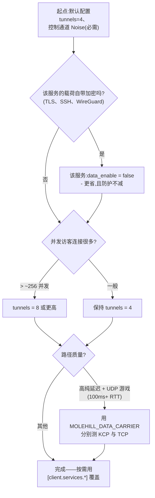

# 配置

`molehill` 从配置文件判断运行模式:`[server]`、`[client]`、`[transparent]`
三者中至少要出现一个,如[快速开始](../README.zh.md#快速开始)中的示例。文件
可以包含多个块,但此时必须用 `--server` / `--client` / `--transparent` 选定
模式;不带标志时进程拒绝猜测。一台机器要扮演两种角色,就跑两个进程。

开箱即用的配置、systemd 单元与容器部署见[部署与示例](./deployment.zh.md)。

加密与 Noise 密钥的更多细节见[传输层文档](./transport.zh.md)。

页面索引:

- [如何配置](#如何配置)
- [选择配置(决策树)](#选择配置决策树)
- [动态服务注册](#动态服务注册)
- [多路复用(`multiplex` 特性)](#多路复用multiplex-特性)
- [透明(L3)服务](#透明l3服务)
- [日志](#日志)
- [调优](#调优)
- [示例与部署](#示例与部署)
- [使用说明](#使用说明)
- [故障排查](#故障排查)

## 如何配置

**服务定义归客户端所有**,服务端只拥有策略:

- 客户端在自己的配置里声明每个要转发的服务——包括它应该暴露的公网地址
  (`remote_bind_addr`)。
- 服务端**没有**任何按服务的配置。客户端连接时在运行时注册服务;服务端
  在暴露任何端口前,都会用 `allow_ports` 白名单校验每次注册。
- 两端用一个共享密钥(`default_token`)鉴权。

一个进程只运行在**三种模式之一**,由配置文件表明是哪一种:`[server]`、
`[client]`(转发)或 `[transparent]`(L3——见[透明(L3)服务](#透明l3服务))。
模式是**进程**的属性——它的能力、它的 socket、它的 TUN 设备——所以同时写了
两张表的文件需要用一个标志选定模式,而一台想扮演两种角色的机器就跑两个进程。
`--server` / `--client` / `--transparent` 覆盖文件里的声明。

典型配置步骤:

1. 选择传输层——`plain` 或 `noise`——`noise` 需要生成一对密钥(见
   [传输层文档](./transport.zh.md))。
2. 编写 `server.toml`:`[server]` 只需 `default_token` 和 `allow_ports`
   白名单,监听地址是 `[server.control].bind_addr`,仅此而已。
3. 编写 `client.toml`:`[client]` 配置相同的 `default_token`,服务端地址是
   `[client.control].default_remote_addr`,每个服务一个
   `[client.services.<name>]`
   块:`local_addr`(你的服务监听的地址)和 `remote_bind_addr`(公网端点)。
4. 先启动服务端,再启动客户端。两端都会持续运行;服务端不可达时客户端
   会自动重试。

> **从 ≤0.6 迁移**:删除整个 `[server.services.*]` 段;把每个服务的
> `bind_addr` 移入客户端的 `remote_bind_addr`;用 `default_token` 替换
> 按服务的 token;在服务端添加 `allow_ports`。两端必须一起升级
> (协议版本已变更)。

> **从 0.7.x 迁移**:客户端侧的键挪进了专用块,数据面也有了显式
> 端点。旧 → 新:
> `[client].remote_addr` → `[client.control].default_remote_addr`;
> `[client].heartbeat_timeout` / `retry_interval` →
> `[client.control].default_*`;
> `[client].mux = false` → `[client.data].default_mode = "direct"`;
> `[client].mux = true` → `[client.data].default_mode = "multiplex"`——而
> `default_mode` 随后也被移除了,因为形态现在由服务类型推导(见下文
> 「迁移:数据面的形态不再是键」)(
> `mux_receive_window` / `mux_max_streams` 两个键已移除——改用内部固定
> 的 yamux 默认值);
> `[client.transport].type = "tcp"` → `"plain"`;
> `[client.transport.tcp].proxy` → `[client.transport].proxy`;
> `[client.transport.tcp].nodelay` / `keepalive_secs` / `keepalive_interval`
> 已移除(改用内部固定默认值)。按服务的 `nodelay` 键在 0.11.2 中移除:TCP_NODELAY 恒开。
> `tls` 与 `websocket` 两个传输取值在 0.8 中已移除:只剩 `"plain"` 与
> `"noise"`,`[client.transport.tls]` / `[client.transport.websocket]` /
> `[server.transport.tls]` / `[server.transport.websocket]` 块也已删除
> (迁移到 `noise`);
> `[server].bind_addr` → `[server.control].bind_addr`(独立的数据面监听
> 可选,用 `[server.data].bind_addr`,默认复用控制监听);
> `[server].heartbeat_interval` → `[server.control].heartbeat_interval`。
> 0.8 客户端侧的默认块统一用 `default_` 前缀命名——`[client.control]`
> (`default_remote_addr`、`default_heartbeat_timeout`、
> `default_retry_interval`)与 `[client.data]`(`default_data_addr`、
> `tunnels`)——以便与
> `[client.services.<name>]` 上的按服务覆盖键(`protocol`、`remote_addr`、
> `token`、`retry_interval`、`transport`、
> `max_udp_workers`、`udp_forwarder_ipv6`、`udp_send_queue_size` 等;
> 0.8 的 `[client.transport]` 表在 0.11.2 中被 `[client.noise]` 取代(见上方 0.11.2 迁移)。
> 按服务的键是 `[client.services.<name>.noise]`。
> (`default_` 前缀正是为了消解同名冲突而存在)。
> 旧键会被拒绝(`deny_unknown_fields`),绝不会被静默忽略。
>
> **0.8 协议**:每条连接以 1 字节传输选择器开头(`0x00` 明文 /
> `0x01` noise),注册消息携带数据面 carrier——两端必须一起升级;版本
> 不匹配是硬错误。
>
> **升级到 0.10(协议 v4)**:客户端改说 v4——每个端点一条控制会话,承载拨向该
> 端点的所有服务,并由服务端在开通通道之前先把 stripe 组命名出来;而 0.10.0 是
> 第一个**只服务 v4** 的版本:v3 客户端的连接会在它发生的那条连接上被拒绝,且
> 不会有任何回包。因此请两端一起升级;先后顺序无所谓,因为每一端都会拒绝对方的
> 方言而不是继续通信,而被拒绝的连接会写明它期待的版本。
>
> **升级到 0.11.0(协议 v5.0)**:线上要承载透明(L3)服务,所以是 v5.0,而
> 0.11.0 **只服务 v5.0**——0.10 对端的连接会在它发生的那条连接上被拒绝、不会有
> 任何回包,反方向也是一样。请两端一起升级;先后顺序无所谓,每一端都会说出它
> 期待的版本。
>
> **升级到 0.11.1(协议 v5.1)**:v5.1 是线协议断裂,不是兼容的小版本:hello
> 里是两字节版本号,透明数据通道还要协商帧格式。0.11.0(v5.0)对端会在它发生的
> 那条连接上被拒绝,两个方向都一样。请两端一起升级,不要混跑版本。
> **升级到 0.11.2(扁平的 Noise 表)**:握手固定为 KK,线协议表也变成扁平的。
> 把 `[client.transport]` / `[client.transport.noise]` 换成 `[client.noise]`,
> `[server.transport.noise]` 换成 `[server.noise]`,
> `[transparent.transport.noise]` 换成 `[transparent.noise]`;把
> `local_private_key` 改名为 `private_key`,`remote_public_key` 改名为
> `public_key`。KK 需要两端的密钥,所以服务端要补上客户端的公钥,客户端要补上
> 自己的私钥(每台主机运行一次 `molehill --genkey`)。`type = "noise"` 变成不写
> `data_enable`(默认 true),`type = "plain"` 变成 `data_enable = false`。
> `pattern`、`psk`、`psk_location`、`resume` 与 `proxy` 没有替代。
> 见[传输层](./transport.zh.md#迁移)。

### 迁移到 0.10:已移除的键

隧道池现在是每个会话、每个 carrier 一个池,并**固定**在配置写明的条数上——因此
那些描述「池的初始大小」「按服务的池」或 0.8 后期健康检查的键都已移除。仍带着这些键的
配置不会启动:拒绝信息会列出它找到的每一个键以及该改写成什么(只写「未知字段」
能告诉你有东西不对,却不能告诉你该写什么)。请改写为:

| 已移除的键 | 改写成 |
|---|---|
| `[client.data].default_count` | 无需填写:池的宽度是 `[client.data].tunnels`,默认 4 |
| `[client.services.<name>].count` | 无需填写:池属于会话,不再属于单个服务。`[client.data].tunnels`(或服务自己的 `tunnels`)是它的宽度 |
| `[client.services.<name>].pool_size` | UDP 服务写 `[client.services.<name>].max_udp_workers`(默认 2)。TCP 服务按访客即时打开数据通道 |
| `[client.services.<name>].heartbeat_timeout` | 无需填写:服务端在会话确认里声明自己的心跳节奏,客户端据此推导超时。`[client.control].default_heartbeat_timeout` 仍作为可选下限保留 |
| `[server].max_pool_size` | `[server.data].max_tunnels`(服务端全局的存活隧道与 lane 上限;不设置 = 由打开文件上限推导,0 = 不限) |
| `[client.services.<name>].health_check` | 无需填写:只要客户端在运行,服务就保持注册;无法转发的请求只对那个访客失败 |

下一节说明每个替代键做什么、代价是什么;[CHANGELOG.md](../CHANGELOG.md) 记录
这些移除的原因。

### 迁移:数据面的形态不再是键

`mode` 已移除。仍带着 `[client.data].default_mode` 或按服务的
`[client.services.<name>].mode` 的配置不会启动:拒绝信息会点名该键并说明该怎么做。
它当初表达的东西,现在是服务类型的一个属性:

| 已移除的键 | 改写成 |
|---|---|
| `[client.data].default_mode` | 无需填写:转发服务永远走多路复用。`[client.data].tunnels` 是它池的宽度 |
| `[client.services.<name>].mode` | 无需填写:形态跟随协议——转发服务多路复用,透明认领永远不 |

认领的通道**就是**它的载体连接——认领的吞吐是**连接**之和,而不是流之和——所以对它
做多路复用等于白付成帧成本:同一台主机、同一份负载下,同一条认领走自己的连接时线上
字节少 6%、每包 CPU 少 33%、每秒往返次数多 65%
([基准测试](./benchmarks.zh.md#透明-l3-的线上开销问题验收-harness))。

### 迁移到 0.11:carrier 与池的时钟

哪一种 carrier 能用是网络的性质,不是部署的性质,所以数据面在运行时选择它
(先 TCP,回退 KCP),而那些用来声明它的键已经移除。池也**固定**了——它在服务启动时
建立、之后只做修复,既不按负载增长、也不因空闲回收——于是没有收缩时钟可配:

| 已移除的键 | 改写成 |
|---|---|
| `[client.data].default_carrier` | 什么都不写:数据面先拨 TCP,数据通道建立不起来时回退 KCP。需要把两条路径分开做测量或测试时用 `MOLEHILL_DATA_CARRIER=tcp\|kcp` 强制其一 |
| `[client.services.<name>].carrier` | 什么都不写 —— 理由同上。服务自己的 `tunnels` 是它仍能写的数据面键 |
| `[client.data.tcp]` | `[client.data].tunnels`:无论跑在哪个 carrier 上,都是一个池、一个宽度 |
| `[client.data.kcp]` | `[client.data].tunnels` —— 同上 |
| `[client.data].idle_timeout` | 什么都不写:固定池不会因空闲被回收,没有超时可设 |

### 迁移到 0.11.2:每条会话一个池

转发客户端现在为整条控制会话只保留一个隧道池,所以描述单服务宽度或池归属开关的键已经移除:

| 已移除的键 | 改成写 |
|---|---|
| `[client.services.<name>].tunnels` | `[client.data].tunnels`:它是会话的总宽度,会话中的所有服务共用它 |
| `[client.data].shared_pool` | 无需填写:每条会话一个池是唯一形态。它的宽度是 `[client.data].tunnels` |
| `[client.services.<name>].nodelay` | 无需填写:所有转发连接都启用 TCP_NODELAY |
| `[client.services.<name>].udp_workers` | `[client.services.<name>].max_udp_workers`:worker 集合的上限,不是启动时的数量 |
| `[client.services.<name>].udp_send_queue_size` | 无需填写:队列是内部的,由 CoDel 管理 |
| `[client.services.<name>].udp_idle_timeout` | 无需填写:对端映射寿命跟随该对端自己的流量 |
| `[client.services.<name>].udp_forwarder_ipv6` | 无需填写:forwarder 跟随 `local_addr` 的地址族 |
| `[client.control].default_retry_interval` | `[client.control].retry_backoff_max`:该键命名的是重试上限;不设置则使用 1-60 秒的自适应默认值 |
| `[client.services.<name>].retry_interval` | `[client.services.<name>].retry_backoff_max`:不设置则继承 `[client.control].retry_backoff_max` |
| `[transparent.control].default_retry_interval` | `[transparent.control].retry_backoff_max`:同一个上限,用于 L3 客户端 |
| `[transparent.claims.<name>].retry_interval` | `[transparent.claims.<name>].retry_backoff_max`:不设置则继承 `[transparent.control].retry_backoff_max` |
| `[transparent.claims.<name>].tunnels` | `[transparent.data].tunnels`:claim 的 lane 数是它在客户端预算中的份额 |
| `[server.data].max_tunnels_per_client` | `[server.data].max_tunnels`:阀门现在是全局的;不设置由打开文件上限推导,0 = 不限 |


## 选择配置(决策树)

第一个选择是模式:`[client]` 转发到本地应用,`[transparent]` 则自己拥有公网地址
(见[透明(L3)服务](#透明l3服务))——这是关于**进程**的选择,不是关于某个服务的,
所以它排在下面所有内容之前。

默认配置——`tunnels = 4` 的固定多路复用连接池、Noise 控制通道(必需),以及先试
TCP、建立不起来再回退 KCP 的数据面——对绝大多数人是正确的起点。只有树上有明确分支时才偏离;每次只改一项,
并在**你自己的路径上**测量结果:已发布的运行、它们的数字以及如何复现,见
[基准测试](benchmarks.zh.md)。本页负责的是**每个设置做了什么**:



### 每个选择的花费(你交换的是什么)

| 决策 | 选项 | 你放弃 / 得到什么 |
|---|---|---|
| `tunnels` | `1` | 所有流量共用一条隧道:没有跨流聚合,且共享同一重传域,一次丢包会一起卡住。实测为所有路径上最差的配置 |
| `tunnels` | `4`(默认) | 聚合越过单流,并在隧道之间隔离队头阻塞;`4 × 64` 并发连接 |
| `tunnels` | `8+` | 更多并行隧道(更多 NAT 映射)与按比例更高的连接上限;在干净快速路径上实测从一条隧道到八条吞吐 +77% |
| carrier | (没有对应的键) | 数据面先拨 TCP,数据通道建立不起来时回退 KCP,因为哪一种能用是网络的性质而不是部署的性质。`MOLEHILL_DATA_CARRIER` 可以强制其一用于测量。实测 TCP 在每一个未做标记的格子上都领先,KCP 唯一的胜场是 100 ms RTT 下的 UDP 会话质量——这正是它先拨 TCP 的原因([基准测试](benchmarks.zh.md#每个配置选择的代价逐项实测)) |
| `data_enable` | `false` | 数据通道走明文;每字节开销最低。控制通道仍为 KK |
| `data_enable` | `true`(默认) | 每条数据与 lane 通道都包进 KK,支付少量 CPU,不增加往返 |
| 池的建立 | (没有对应的键) | 池的 `tunnels` 条连接在服务启动时拨出,而不是在第一个访客到来时:请求时不需要付任何代价,成本是 `tunnels` 条空闲连接(实测每条 0.5–0.8 MiB RSS 与 2.6 个 FD,不占线程) |
| `max_udp_workers` | 2(默认) | 仅 UDP:服务 worker 集合的上限。只启动一条数据通道,仅在服务端请求(队列压力)时增长,空闲 worker 会退休;不同访客分片到存活 worker 上,单个访客绝不被拆开。它不提高报文上限,实测见[基准测试](benchmarks.zh.md#udp-队列问题仅-molehill-的诊断) |

各选项的**实测代价**——这些取舍所依据的数字及其来源——见
[基准测试](benchmarks.zh.md#每个配置选择的代价逐项实测)。

**验证选择**用你关心的口径:延迟用 `ping` / 游戏手感,原始吞吐用暴露端口的
`iperf3`,真实流量看暴露服务的行为。要在自己的硬件上比较两套配置或两个构建,
命令见[基准测试](benchmarks.zh.md#自己复现)。

以下是完整的配置规范:

```toml
[client]
default_token = "change-me" # 必填。必须与 `[server].default_token` 一致

[client.control]
default_remote_addr = "example.com:2333" # 必填。服务端地址
# default_heartbeat_timeout = 65 # 可选。应用层心跳超时。不设置(默认)时由服务端在会话确认里声明的节奏推导:`max(10 秒, 2 × server.control.heartbeat_interval + 5 秒)`。低于该下限的取值会在启动时被拒绝(否则会把健康的服务端判死);设为 0 禁用检测
retry_backoff_max = 30 # 可选。重连退避的上限,而非固定间隔:延迟按 3 倍增长并带抖动,最高不超过该值(抖动会让单次睡眠最长达到该上限的两倍)。不设置 = 自适应:随着连续失败次数增长依次为 1、2、4、8、16、32、60 秒。设置该值会把每次故障的上限固定下来

[client.data]
# default_data_addr = "example.com:2343" # 可选。数据面端点;默认为服务的控制端点(设置了 `client.services.<name>.remote_addr` 时用该地址,否则用 `client.control.default_remote_addr`)。KCP 回退的会话用 UDP 拨该地址,所以 TCP 控制通道与 KCP 数据面可以共用一个端口(协议不同互不冲突)
# tunnels = 4 # 可选。会话唯一隧道池的宽度:客户端为它承载的所有服务持有多少条载体连接。默认:4。必须 `>= 1`;大于 64 的值会被收敛到 64
# 这里刻意**没有** carrier 键:数据面先试 TCP,数据通道建立不起来时回退到 KCP(特性 `kcp`),因为哪一种能用是网络的性质而不是部署的性质。透明声明还会在**运行中**搬动车道:每条车道都有独立度量(服务端向它投递了多少、该车道队列拒收了多少、客户端从它注入了多少),当所用 carrier 拒收的比例达到材料性门槛时,该车道会被换到另一条 carrier——对端停止往它放新流,两端都确认其中已无流后才退役,因此正在进行的流在原有车道上跑完、不会被重排。`MOLEHILL_DATA_CARRIER=tcp|kcp` 可以强制其一,用于需要把两条路径分开的测量或测试——它同时会关闭回退与自动搬移


[client.noise]

private_key = "8JlJQXXN0lFqz5ghIjJRq3bfRiCDKJHuXxbfu5jIxWE=" # example key # security-scan:allow documentation example key
public_key = "mEnUEACy9UrTBmwoCJb6fcKWBRdvfD9XzuBVsroOLFg=" # example key # security-scan:allow documentation example key
data_enable = true # 可选。加密该客户端的数据通道(隧道与 lane)。默认:true;控制通道恒为 Noise

[client.services.service1]
protocol = "tcp" # 可选。需要转发的协议。可选值:["tcp", "udp"]。默认:"tcp"。必须自己拥有公网 ip:port 的服务根本不是转发服务:它属于 `[transparent]` 表,那是一种独立的运行模式——见下文「透明(L3)服务」
local_addr = "127.0.0.1:1081" # 必填。需要被转发的本地服务地址;它是被拨号的一方,必须是 host:port,没有可用端口的取值会在加载配置时被拒绝
remote_bind_addr = "0.0.0.0:8081" # 必填。该服务在服务端暴露的公网地址。必须被服务端的 `allow_ports` 覆盖
retry_backoff_max = 30 # 可选。按服务的重连退避上限,语义与 `client.control.retry_backoff_max` 相同。默认:继承 `client.control.retry_backoff_max`,再回落到自适应默认值
token = "service-specific-token" # 可选。仅对本服务覆盖 `client.default_token`——例如对使用独立 token 的服务端做鉴权 # security-scan:allow documentation placeholder
remote_addr = "server2.example.com:2333" # 可选。仅对本服务覆盖 `client.control.default_remote_addr`——它的控制通道(默认还包括数据面)拨向这个服务端。让同一个客户端可以把服务分散到多个 molehill 服务端

[client.services.service2]
protocol = "udp"
local_addr = "127.0.0.1:1082"
remote_bind_addr = "0.0.0.0:8082"
max_udp_workers = 2 # 可选。仅 UDP:该服务 worker 集合的上限(1..=64)。客户端只启动一条数据通道,仅在服务端请求时增长到该值;空闲 worker 会退休。默认:2
udp_buffer_size = 2048 # 可选。UDP 接收缓冲区,单位字节。默认:2048,最大 65535

[server]
default_token = "change-me" # 必填。必须与 `[client].default_token` 一致
allow_ports = ["6000-6999", "8080"] # 启用动态注册的必填项。为空或缺失:拒绝所有注册。请求的端口只要被某个条目包含就会被放行(单个端口,或覆盖它的范围——1024 以下的特权端口同样如此)

[server.control]
bind_addr = "0.0.0.0:2333" # 必填。服务端监听客户端连接的地址。通常只需改端口
heartbeat_interval = 30 # 可选。两次应用层心跳之间的间隔。不设置 = 自适应:最多 8 条会话为 30 秒,最多 32 条为 60 秒,更多为 120 秒。设为 0 禁用心跳

[server.data]
# bind_addr = "0.0.0.0:2343" # 可选。数据面监听地址;默认为 `server.control.bind_addr`。KCP UDP 监听也在第一条 `kcp` 注册到达时绑定到这里——默认地址下,TCP 控制与 UDP KCP 共用一个端口(协议不同互不冲突)
# max_tunnels = 0 # 可选。服务端全局的存活承载连接阀门:每个客户端的每条多路复用隧道与每条透明 lane 都计入。不设置 = 由进程的打开文件上限推导;0 = 不限。超过上限的连接会被带类型地拒绝并写明上限,会话继续运行

[server.noise]
private_key = "kQiSRtS3bs8BoGCJYgFnl1FLrTG1lV53Dj8jSjmg8tE=" # example key # security-scan:allow documentation example key
public_key = "zDdpcSQP+7Y5Mr+7UdEZMkz3gO6NGbQ1hko8/yt5knE=" # example key # security-scan:allow documentation example key

[server.transparent]
tun = "molehill0" # 可选。服务端的 TUN 设备。默认:Linux 与 Windows 为 molehill0,macOS 为 auto(自动选择空闲 utunN)。Linux 上设备缺失时由守护进程创建,已存在则原样使用;macOS/Windows 上由守护进程创建,运维方负责路由/转发
```

## 动态服务注册

不再有 `[server.services.*]` 块。生命周期如下:

1. 客户端用 `default_token` 鉴权。
2. 对每个配置的服务,客户端发送 `RegisterService` 消息:名称、
   `protocol`(tcp/udp)、`remote_bind_addr`、将要使用的数据面
   `carrier`(tcp/kcp——`kcp` carrier 会触发服务端懒绑定 UDP 监听)与
   UDP 缓冲大小。通道数不在消息里:客户端打开自己配置的通道(TCP 每个访客
   一条,UDP 为 `max_udp_workers` 条,透明认领为该 carrier 分给它的车道数——
   长生命周期连接),服务端在访客到达或某条通道结束时再要一条。
3. 服务端校验:
   - **白名单**:请求的端口必须被 `allow_ports` 覆盖;为空/缺失的
     `allow_ports` 会拒绝*每一次*注册(这也是完全禁用该特性的方式);
   - **特权端口**:没有单独规则——白名单条目(单个端口或范围)同样
     放行其中的 1024 以下端口。绑定它们仍会失败,除非服务端具备操作系统
     特权(root,或调低
     `net.ipv4.ip_unprivileged_port_start`);所以服务端确有特权时,
     建议把要暴露的特权端口逐个列出;
   - **冲突**:端口已被占用时,注册失败并返回 `Port already in use`。
4. 成功时服务端立即绑定该端口并开始转发。

被拒绝对该服务的本次运行是永久性的:客户端记录服务端返回的具体原因并
放弃,直到你修复配置或重启。服务名在同一服务端内必须唯一;重启的客户端
重新注册时会干净地接管。

## 多路复用(`multiplex` 特性)

`multiplex` 特性是默认特性集的一部分。注册的转发服务跑在一个**固定的隧道池**上
(`[client.data].tunnels`,默认 4),它承载的每条数据通道都变成其中
一条隧道内的 yamux 流。这消除了每条连接的握手延迟
(TCP 连接,以及 `noise` 下的 Noise 握手),并在大量并发访客下大幅减少
FD 占用。形态不是键:转发服务永远走多路复用(没有 `mode` 可写),
而[透明认领](#透明l3服务)永远不走。

- 决定权只在客户端;服务端按连接自动适配。
- 每条隧道的缓冲由内部固定默认值约束(32 MiB yamux 接收窗口、64 条流):
  丢包积压有界且吞吐无损;这两个值固定是因为 yamux 将两者耦合(见
  internals.md)。
- **池在服务启动时建立并固定。** 全部 `tunnels` 条连接在服务激活时就拨出,
  因此第一个访客不需要付任何代价(建连成本在它到来之前就已支付),而一个部署
  提供的容量不取决于它一分钟前恰好在做什么。池永远不会为负载调整大小,空闲
  隧道也永远不会被回收。
- **修复是唯一的例外**,而且它不是增长:死亡的隧道会被替换,直到重新满足条数,
  因此单次故障不会永久缩小一个部署。*不*被修复的是条数本身——池需要更宽就得
  提高 `tunnels` 并重启客户端,这正是重点:容量是配置决策,不是运行时决策。
- `tunnels = N` 是该 carrier 的池持有多少条 carrier 连接。独立 TCP 流
  隔离队头阻塞(丢段只停滞自己的隧道),并可超越单条流的拥塞窗口聚合吞吐。
  某条隧道死亡时,开启请求会透明地落到存活隧道,修复 tick 会拨一条替代。
  默认:4;`1` 恢复单隧道行为,
  但要付实测代价——在模型的各格子里,一条隧道是所有路径上最差的配置,因为
  此时每条流共享同一个拥塞窗口。
- **负载超过池时**发生的是分担,不是增长:流会摊到现有的隧道上,每条隧道最多
  56 条,而当所有隧道都到该上限时到来的访客会短暂等待某条流退出,若没有流
  退出就被拒绝。按你预期的并发量为 `tunnels` 定容;定容所依据的实测见
  [基准测试](benchmarks.zh.md#每个配置选择的代价逐项实测)。
- **carrier 不是你要写的选项。** 数据面先拨 TCP,数据通道建立不起来时回退到 KCP
  (特性 `kcp`,属于默认特性集)——因为哪一种能用取决于两端之间的网络:UDP 可能被封、
  被整形,也可能今天通明天不通。回退会以 `INFO` 播报一次、每 60 秒重新探测一次,
  而池或车道一旦建立,承载方式就不再改变。想把两条路径**分开测量**,或复现一个
  必须走 TCP 的测试,用 `MOLEHILL_DATA_CARRIER=tcp|kcp` 强制其一——它同时关闭
  回退。两条路径的实测对比见[基准测试](benchmarks.zh.md#每个配置选择的代价逐项实测)。
  加密开启时,同一套 Noise 握手也包住每个 KCP 会话——
  Noise 握手包裹每个 KCP 会话——数据通道仍由 yamux 承载,`tunnels` 照常生效。
  服务端在第一条来自「能走 KCP 的客户端」的注册到达时才打开 UDP 监听——绑定
  失败会变成精确的注册拒绝;不带 `kcp` 特性的客户端不会让服务端打开 UDP
  socket。客户端先拨 TCP、但在注册里声明自己**能**走 KCP,所以回退所需的监听
  在需要它之前就已经在了。
  监听绑定在数据地址上(`[server.data].bind_addr`,默认 = 控制地址),每个
  会话像 TCP 隧道一样用控制会话的 nonce 认证。如果两端都不设置数据地址,**TCP 控制
  与 UDP KCP 就共用一个端口号**:TCP 和 UDP 是不同协议,两个 socket 绑定同一端口
  不会冲突(记得在防火墙/NAT 里同时放行两种协议)。固定的 KCP 参数(为可比性记录):
  流模式、nodelay 10 ms 间隔、fast-resend 2、关闭拥塞控制、发送窗口 8192 /
  接收窗口 4096 段(发送窗口就是有损路径上的吞吐天花板:2048 段在约 44 ms 往返下
  只能承载 533 Mbit/s;改成 8192 后由对端 4096 段的窗口成为上限,既拆掉这个天花板,
  又不改变干净路径上的数字)、**数据报大小跟随路径**(1400 字节——任何路径都能承载——在路径
  自身 MTU 允许时最高 8 KiB;内核给出的路径 MTU 每秒重读一次,因此在 1500 字节路径
  上的会话永远不会发出需要分片的数据报)、32 MiB socket 缓冲。保活:适配器层每 2 秒的
  PING/PONG 让空闲隧道保持活跃(NAT 映射)并探测路径 RTT;对端消失仍只在
  下一次写入时确认:当某个分片被重传约 20 次**且**发送窗口已连续五秒没有推进时才
  判定会话结束,因此只是"慢"的对端(例如确认排在整形器队列之后)不会被误判为消失。
- 编译时去掉该特性则完全移除这个选项,而且这样的构建根本不能看到相应的表:
  配置里出现 `[client.data]` 或 `[server.data]` 就会被拒绝(未知键——
  `deny_unknown_fields`)。删掉这两个表之后,每条数据通道都是自己的一条连接。

**分开绑定数据面。** 默认情况下两个平面共用控制地址。要把数据面放到独立端口,
两端都要设置:

```toml
# server.toml
[server]
default_token = "change-me"
allow_ports = ["5202"]

[server.control]
bind_addr = "0.0.0.0:2333"

[server.data]
bind_addr = "0.0.0.0:2343"

[server.noise]
public_key = "zDdpcSQP+7Y5Mr+7UdEZMkz3gO6NGbQ1hko8/yt5knE=" # example key # security-scan:allow documentation example key
private_key = "kQiSRtS3bs8BoGCJYgFnl1FLrTG1lV53Dj8jSjmg8tE=" # example key # security-scan:allow documentation example key
```

```toml
# client.toml
[client]
default_token = "change-me"

[client.control]
default_remote_addr = "server.example.com:2333"


[client.noise]
private_key = "8JlJQXXN0lFqz5ghIjJRq3bfRiCDKJHuXxbfu5jIxWE=" # example key # security-scan:allow documentation example key
public_key = "mEnUEACy9UrTBmwoCJb6fcKWBRdvfD9XzuBVsroOLFg=" # example key # security-scan:allow documentation example key

[client.data]
default_data_addr = "server.example.com:2343"

[client.services.echo]
local_addr = "127.0.0.1:8080"
remote_bind_addr = "0.0.0.0:5202"
```

服务端会在 `[server.data].bind_addr` 上再绑一个 TCP 监听,并在第一条来自
「能走 KCP 的客户端」的注册到达时打开该地址的 KCP UDP socket;这个端口要同时放行
**TCP 与 UDP**。带自己
`remote_addr` 的服务会同时跟随该服务端的两个平面,客户端级的
`default_data_addr` 不作用于它。

**按服务覆盖。** `[client.data]` 存放默认值;每个服务可以在自己的
`[client.services.<name>]` 块里单独覆盖 `tunnels`,数据面的其它部分不可覆盖:
carrier 随路径而定,形态随协议而定。于是同一个客户端可以给繁忙的服务更宽的池,
或让两个服务共用一个池,服务端无需任何配置改动:服务端按连接自动适配,并在第一条
声明该 carrier 的注册到达时打开自己的 KCP 监听(没有按 carrier 的服务端配置)。同样的覆盖
模式也适用于控制默认值:`token`、`remote_addr` 分别覆盖
`[client].default_token`、`[client.control].default_remote_addr`,
`retry_backoff_max` 覆盖控制级的重试上限。心跳不是按服务的旋钮:一条
会话只有一个计时器,由服务端声明的节奏推导(见
`[client.control].default_heartbeat_timeout`)。`default_data_addr` 本身不能按
服务设置——数据面端点会跟随该服务自己的服务端(见下)。

**多服务端。** 服务也可以覆盖服务端本身:`[client.services.<name>].remote_addr`
为该服务的控制通道替换 `[client.control].default_remote_addr`,数据面默认
跟随(隧道拨同一个端点,因为服务端的数据监听默认就在控制地址上)。于是
同一个客户端可以把服务分散到多个 molehill 服务端——每个区域就近的副本、
按租户分服务端,或者逐个迁移服务的窗口期。每个服务端都必须用 token 认证
服务:某服务端与客户端 `default_token` 不同时,该服务可以带自己的 `token`;
每个服务端的 `allow_ports` 必须覆盖注册在它上面的服务,而客户端会按各个
服务端声明的节奏分别推导该会话的心跳超时,因此节奏不同的服务端可以共存。
数据面端点解析链是:服务自己的 `remote_addr` →
`[client.data].default_data_addr` → `[client.control].default_remote_addr`
——因此全局 `default_data_addr` 只作用于没有自己 `remote_addr` 的服务;某个
服务端把数据监听放在独立端口(不同的 `[server.data].bind_addr`)时,需要
在 `[client.data].default_data_addr` 里全局设置该地址,它会作用于所有跟随
客户端级端点的服务。

线级设计——隧道升级、每流分帧与窗口,以及池化流为何需要 SYN 启动——
见[内部原理](./internals.md)。

## 透明(L3)服务

透明(L3)客户端把公网 `ip:port` 交给**客户端**拥有,而不是让服务端绑定它。
客户端的宿主机在自己的 TUN 设备上承载所声明的地址,服务端把整个 IP 包路由进隧道,
由客户端自己的内核应答访客——因此后端看到访客的真实源地址,TCP 保持端到端语义,
服务端也不为该连接持有任何 socket 或按流的状态。

它是**独立的运行模式,有独立的配置模型**:一张 `[transparent]` 表,用
`molehill <配置> --transparent` 启动(也可以不带参数,因为这张表本身就说明了这个
进程是什么)。它的每个服务都是对一个公网地址的**认领**,所以没有 `protocol` 键去
切换条目的性质,转发服务会用到的键在 schema 里根本没有位置:`local_addr`、`nodelay`
与仅限 UDP 的那些键是**写不出来**,而不是写出来再被拒绝。`[client.services.<name>]`
里的 `protocol = "transparent"` 会被拒绝并指向这里;同时写了 `[client]` 与
`[transparent]` 的文件也会被拒绝——既转发又认领的机器跑**两个进程**,这也正是让
`CAP_NET_ADMIN` 不落到不需要它的那个进程上的办法。

它支持 **Linux 与 macOS**,**Linux、macOS 或 Windows 服务端**都可以提供;
Windows **不能做客户端**:它的协议栈没有源地址策略路由,应用发出的回包回不到
隧道,因此 Windows 上的 `[transparent]` 客户端配置会在解析时被拒绝,并给出
WSL2 的指引。`transparent` 特性属于默认特性集。不支持的平台、或在不含该特性
的构建里,都会在解析配置时被拒绝并说明原因与可用方案。

设备生命周期按平台分工,守护进程只负责设备,以及客户端上的认领地址。Linux 上
设备缺失时由守护进程创建持久 TUN,已存在则原样使用;客户端上它还会把尚未配置的
认领地址配上去。路由、策略规则与转发开关仍归运维方,进程需要
`CAP_NET_ADMIN`。macOS 上守护进程创建临时的 `utunN`,并在客户端把所声明的
`/32` 或 `/128` 配到它上面,运维方负责 pf 规则与路由,进程需要 root。Windows 上守护进程
创建 Wintun 适配器,运维方负责路由、转发与防火墙规则,进程需要管理员权限与放在
二进制旁边的 `wintun.dll`。IPv4 与 IPv6 都承载:解析器支持 IPv6 基础头、常见
扩展头链(含分片)和 TCP/UDP 端口;ICMPv6 与 ESP 只按地址路由。IPv6 jumbogram
不承载(按 malformed 拒绝),解析器不认识的扩展头之后的传输头也按地址路由。
版本既不是 4 也不是 6 的包会被丢弃并计数。

**服务不服务 L3,由服务端运维决定。** 在服务端,`[server.transparent]` 这张表
就是开关:没有它,认领会在看任何设备之前被策略拒绝,所以客户端永远不可能成为
"让服务端去打开设备、向内核索要相应权限"的原因。只转发
`tcp`/`udp` 的服务端因此完全不需要这项能力。启用 L3 有一个后果要直说:这类客户端
永不加密,所以服务它的服务端会接受来自该客户端的明文连接,无论
`[server.noise]` 写了什么——Noise 键仍然作用于真正协商了它的客户端。

**守护进程只创建设备,以及客户端上的认领地址。** 它不在任何平台安装路由、策略
规则或防火墙规则:Linux 上它创建缺失的 TUN 设备并校验运维方配置的状态。已存在的
设备原样使用,所以想指定 MTU 就先自己创建;客户端上已经配好的认领地址也不会被
改动。macOS 创建 utun 并在客户端配置认领地址,Windows 服务端创建 Wintun 适配器。
退出时保留这些状态。它们之外的一切仍归运维方,三个平台一致:服务端的转发与每条
认领的路由、客户端的策略规则与表路由、macOS 的 pf 规则、Windows 的路由与防火墙
规则。[部署文档](./deployment.zh.md#透明l3服务)里有完整配方。

| 键 | 含义 |
|---|---|
| `[transparent]` | **模式本身**:这张表让进程成为 L3 客户端,客户端级的那一半也在这里(`default_token`、`tun`、`control`、`data`、`noise`) |
| `[transparent.status]` | 可选的只读状态 API,形态与 `[client.status]` 相同:`bind_addr` 与非空 `token` |
| `[transparent.claims.<name>]` | 一个被认领的公网地址。名称标识该认领(显示在日志中) |
| `[transparent.claims.<name>].remote_bind_addr` | 客户端**声明拥有**的公网 `ip:port`。端口必须被服务端的 `allow_ports` 覆盖——认领和别的注册一样;地址必须是客户端本地的(配方会把它配到 TUN 设备上)。IPv4 写 `10.99.0.1:8443`,IPv6 写 `[2001:db8::1]:8443` |
| `[transparent].tun` | 客户端连接的 TUN 设备。默认:Linux 与 Windows 为 `molehill0`,macOS 为 `auto`(自动选择一个空闲 `utunN`) |
| `[transparent.data].tunnels` | **车道预算**:这个客户端为它所有认领一共持有多少条载体连接,在认领之间平分。一条车道**就是**一条连接(认领永远不做多路复用),且每条认领至少保留一条。默认:**每条认领两条**——一个实测的拐点,代价写在表下。低于认领数的预算会被拒绝并给出该写入的条数;上限 1024。平分只是车道的**起点**:承载的流比车道更多的认领,会从还有空闲车道的认领那里借走一条(但绝不借走最后一条),也就是说预算是「存在多少条连接」的决定者,而谁持有它们由流量决定。认领数的非整数倍预算会剩下除不尽的部分不被分配——分配器重新分配各认领的份额,不会去花除法剩下的余数;想让每条车道都用上,就把预算写成认领数的整数倍 |
| `[server.transparent]` | **开关**:这张表存在,服务端才会提供 L3。缺失时,每一次认领都会在看任何设备之前被策略拒绝 |
| `[server.transparent].tun` | 服务端连接的 TUN 设备。默认:Linux 与 Windows 为 `molehill0`,macOS 为 `auto`(自动选择一个空闲 `utunN`) |

按认领的键与转发服务一一对应:`token`、`remote_addr`、`retry_backoff_max` 与
`noise`。`[transparent.noise]` 携带 KK 密钥对与 lane 的开关:

- **控制通道永远是 KK。** 它发布的会话 nonce 是每条 lane 认证所用的凭证,明文
  控制段等于把该凭证交给路径上的所有人。密钥写在 `[transparent.noise]`,必填。
- **lane 默认明文。** lane 承载的是访客自己的 IP 包——访客的 TLS 是端到端的保护,
  逐包加密花费的是被承载流量没有要求的 CPU。`data_enable = true` 用同一对密钥
  打开 lane 加密。
- 认领可以用 `[transparent.claims.<name>.noise]` 覆盖密钥对或开关;未设置的字段
  继承 `[transparent.noise]`。
- 没有拨号代理键。

设备名写在 `[transparent].tun`。

认领没有 carrier 键,因此少了一件会写错的事:每条车道跑在数据面拨到的任何载体上
(TCP,回退 KCP),载体的会话**就是**数据通道,其上没有多路复用器。认领真正要选的是它
拿到几条车道(`[transparent.data].tunnels`)。认领永远不做多路复用:它的车道就是它的载体连接,其吞吐是这些连接之和。在同一主机、
同一负载下实测:同一条认领走自己的连接时线上字节少 6%、每包 CPU 少 33%、
每秒往返次数多 65%
(见[基准测试](./benchmarks.zh.md#透明-l3-的线上开销问题验收-harness))。

`[transparent.data]` 接受与 `[client.data]` 相同的键(`default_data_addr` 与
`tunnels`),另外还多一个 `lend`(默认 `true`):某条认领的空闲车道是否可以借给「流比车道多」的同级认领。`lend = false` 即把平分
结果固定下来;这个机制值不值取决于路径的瓶颈在哪(见[基准页](./benchmarks.zh.md))。条数
在这里的含义也不同:转发服务的 `tunnels` 是池的宽度,而认领的是一份连接预算,因为这里
没有池;每条认领分到的份额是 `tunnels / 认领数`,且永不低于一条。

**`tun` 是接口名,不是展示标签。** Linux 上守护进程创建或连接的正是这个名字,
运维方的每条路由/规则也必须用它;macOS 上 `auto` 会解析成一个空闲的 `utunN`
(会打进日志,所以静态 pf 规则要写明确的 `utunN`);Windows 上它是 Wintun 适配器
的名字。服务端与客户端各有一份,不必相同。

**这份预算的缺省值是每条认领两条车道,而这是一笔交易,不是偏好。** 认领的数据路径
是按车道串行的(一个设备读取者、一个注入者),所以繁忙认领的吞吐跟着车道数走,而它给
「所有认领共享的那个读取者」施加的压力也一样。两条轴都测过(同一主机、同一二进制、
五条认领、八条内部流):

| 每条认领车道数 | 只看 bulk | 身边另有一条交互流时 |
|---|---|---|
| 1 | 2.351 Gbit/s | 撑住 8 条流,平台 2.35 Gbit/s |
| **2** | **3.283(+40%)** | **8 条流——斜坡的上限——3.32 Gbit/s,p99 2 ms** |
| 4 | 5.191(+121%) | **3 条流**,四条流起 p99 271 ms,五条流 560 ms |
| 8 | 5.255 | — |

四条车道多买到 58% 的 **bulk** 吞吐,代价是交互流的余量,所以缺省值是两条:bulk 的
天花板可以靠写出 `tunnels` 去拿,而 SLO 不是缺省值可以悄悄弄坏的东西。(量于
v0.11.0 之前的二进制;该版本起吃的分段 offload 抬高了 bulk 一列的绝对值,但
**形状**——两条处的拐点、越过它的 SLO 代价——才是这张表标的价,而且 SLO 一列
受探针约束而非吞吐约束,不会随之移动。)代价按连接数
计:`车道数 x 认领数` 条连接,每条一个 socket、**两端各约 2.6 个文件描述符与
0.5–0.8 MiB RSS**,再占服务端 `[server.data].max_tunnels` 全局阀门
(默认不限)。只承载**单条**流的认领从多出的车道里得不到任何东西(一条到八条:
1.966 / 1.962 / 2.050 / 2.087 Gbit/s),所以服务很多认领、或每条认领只有一条连接的
客户端应当写出 `tunnels` 以少付一些。**升级提示:** 这个缺省值原本是每条认领一条车道,
想保留那种行为的部署把 `tunnels` 写成等于认领数即可。

`tunnels = 4` 配两条认领时每条分到两条连接;`tunnels = 1` 配两条认领会被拒绝,并在
信息里给出应当写入 `2`。认领的内部流会摊在它的车道上(每条流按五元组哈希落在一条
车道上),所以承载大量并发连接的认领想要超过一条连接的吞吐,靠的就是更多车道。

### 运维方需要准备什么

平台决定哪一半属于运维方:

| | Linux | macOS | Windows(仅服务端) |
|---|---|---|---|
| 设备 | 设备缺失时由守护进程创建持久 TUN;想指定 MTU 就先自行创建 | 守护进程创建 `utunN` | 守护进程创建 Wintun 适配器 |
| 所声明地址 | 设备上还没有该地址时由守护进程配置 `/32` 或 `/128` | 守护进程配置每个 `/32`/`/128` | 不配置地址,只做路由 |
| 路由 | 运维方(`ip route`/`ip rule`) | 运维方(`route` + pf) | 运维方(`New-NetRoute`) |
| 权限 | `CAP_NET_ADMIN` | root | 管理员 + `wintun.dll` |
| 校验 | 设备、地址、`rp_filter`、`ip_forward` | 守护进程创建设备/地址;pf 与路由归运维方 | 守护进程创建设备;路由/转发/防火墙归运维方 |

- **Linux:** 设备缺失时由守护进程创建,客户端上尚未配置的认领地址也会被配上;
  已存在的设备原样使用。客户端需要 `net.ipv4.conf.<tun>.rp_filter` 与
  `net.ipv4.conf.all.rp_filter` 都为 `0`;服务端需要 `ip_forward = 1`。缺少
  前置条件时会拒绝并打印要执行的命令。
- **macOS:** 客户端所声明的 `/32` 或 `/128` 由守护进程配置。运维方安装 pf 的
  `route-to` 规则,把来自这些地址的回包送回 utun;服务端打开
  `net.inet.ip.forwarding` 并把每个认领路由到它的 utun。pf 规则是静态的时,
  请写固定的 `tun = "utunN"`;`auto` 会在日志里打印实际名称。已配置的地址在
  进程生命周期内保留:热重载移除的认领,其地址要到重启才消失。
- **Windows:** 服务端的 Wintun 适配器由守护进程创建。运维方为每个认领添加
  路由并打开转发/防火墙规则;客户端不支持(用 WSL2)。

完整配方见[部署文档](./deployment.zh.md#透明l3服务)。

### 一个完整示例

```toml
# server.toml - 服务端不为该服务绑定任何东西:它把 10.99.0.1/32 路由进自己的
# TUN 设备。最后一张表就是允许它这么做的开关:去掉它,下面的注册会被策略拒绝。
[server]
default_token = "change-me"
allow_ports = ["8443"]

[server.control]
bind_addr = "0.0.0.0:2333"

# 控制通道始终使用 Noise —— 必需
[server.noise]
public_key = "zDdpcSQP+7Y5Mr+7UdEZMkz3gO6NGbQ1hko8/yt5knE=" # example key # security-scan:allow documentation example key
private_key = "kQiSRtS3bs8BoGCJYgFnl1FLrTG1lV53Dj8jSjmg8tE=" # example key # security-scan:allow documentation example key

[server.transparent]
tun = "molehill0"
```

```toml
# client.toml - 客户端拥有 10.99.0.1:8443,并在自己的 TUN 设备上承载该地址,
# 应用就绑定在那里。一张表一种模式:这个进程只做认领,不做别的。
[transparent]
default_token = "change-me"
tun = "molehill0"

[transparent.control]
default_remote_addr = "203.0.113.5:2333"

# 控制通道的密钥对 —— 必需
[transparent.noise]
private_key = "8JlJQXXN0lFqz5ghIjJRq3bfRiCDKJHuXxbfu5jIxWE=" # example key # security-scan:allow documentation example key
public_key = "mEnUEACy9UrTBmwoCJb6fcKWBRdvfD9XzuBVsroOLFg=" # example key # security-scan:allow documentation example key

# 转发客户端提供的同一个只读状态 API(可选)
# [transparent.status]
# bind_addr = "127.0.0.1:9090"
# token = "a-long-random-string" # security-scan:allow documentation placeholder

[transparent.claims.web]
remote_bind_addr = "10.99.0.1:8443"
```

多个认领只有在端口不同时才能声明同一个地址;而没有端口可路由的包——ICMP,以及
首个分片之后的分片——只有在恰好一个认领声明该地址时才会投递,否则宁可丢弃也不
猜测。`MOLEHILL_L3_STATS=1` 每秒打印一次数据面的累计计数(见
[诊断开关](#诊断开关按需开启));两端各自如何判断一个包属于哪个服务,见
[内部原理](./internals.md#transparent-l3-services)。

## 日志

和许多 Rust 程序一样,`molehill` 用环境变量控制日志级别。可选 `info`、
`warn`、`error`、`debug`、`trace`。

```shell
RUST_LOG=error ./molehill config.toml
```

以上命令只输出 error 级别的日志。

未设置 `RUST_LOG` 时,默认日志级别为 `info`。

日志行带彩色级别(红色 ERROR、黄色 WARN、绿色 INFO、青色 DEBUG、紫色
TRACE)和当前 span 上下文,例如 `handle{service=ssh}:`——繁忙服务端的每
一行日志都告诉你它来自哪个服务。颜色只在终端上启用;重定向输出保持纯文本
(同样遵循 `NO_COLOR`)。`debug`/`trace` 级别下每行末尾会附加来源模块。

### 各级别的含义

级别表达的是**谁需要行动**,而不是事件听起来多严重:

| 级别 | 含义 | 例子 |
|------|------|------|
| `ERROR` | 需要人介入,工具自己解决不了 | 服务端拒绝了注册、监听器无法 accept、退避重试放弃 |
| `WARN` | 软件已自行处理,但值得留下一行 | 已被移除、当前被忽略的配置键;服务端拒绝了 token |
| `INFO` | 生命周期:某个东西启动、停止或改变了状态 | 服务注册成功、控制通道建立、关闭 |
| `DEBUG` | 单条连接或单次会话自己的事 | 访客的本地服务拒绝连接、数据通道结束、首次之后的每次重试 |

有几条值得写明的后果,它们正是让繁忙日志保持可读的原因:

- **一次失败的请求不是 WARN。** `local_addr` 拒绝连接的访客就是一条被关闭
  的连接,那一行是 `DEBUG`;访客看到什么见
  [本地服务未运行](#本地服务未运行)。
- **会重复出现的状况只报告一次。** 客户端先于服务端启动、或用错误的 token
  不断重试时,只产生一条 `INFO`/`WARN`,之后直到恢复都是 `DEBUG`;一次健康
  的运行不会产生任何 `WARN` 或 `ERROR`。`tests/log_budget_test.rs` 用真实
  二进制测量这一点,所以这是被强制执行的保证,而不是意图。
- **`RUST_LOG=debug` 是排障级别**,内容多是预期之中的:每条连接的细节都在
  那里。

### 诊断开关(按需开启)

六个环境变量用于打开聚合诊断,每个对象每秒一行 `INFO`;另有一个用于强制数据面的
carrier,还有两个用于安排诊断性的 carrier 切换(认领一个、隧道一个)。前六个默认关闭,
从不改变转发路径;打开开关本身就是许可——需要把 `RUST_LOG` 提上去才看得见的行,
永远不会落到任何地方:

| 开关 | 输出 | 内容 |
|---|---|---|
| `MOLEHILL_MUX_STATS=1` | 每个 tunnel 每秒一行 | yamux 组帧累计计数(`written`、`read`、`bytes`)——即每秒帧数,配上一次 CPU 采样就是每帧 CPU |
| `MOLEHILL_KCP_STATS=1` | 每进程每秒一行 |
| `MOLEHILL_TUNNEL_STATS=1` | 每进程每秒一行 | 每条多路复用隧道承载的字节数,格式 `序号:已交付/已写入`,按 pool 的 tunnel 顺序编号(旁边的 pool-stats 行才有 tunnel 名)——车道计数在 L4 的对应物,用来判断不同 carrier 上的隧道速率是否有材料性差异。计数本身是每条隧道上每轮 IO 两次 relaxed 原子加;该开关只启动报告线程 |
 KCP 适配器的累计计数(`datagrams_in`/`out`、`retransmits`、`acks_out`、`sacks_sent`、`blobs_out`、pump 轮数、`datagram_b`——最后一个会话自适应到的数据报尺寸,回答尺寸问题就靠它)以及把单个 segment 的用户态开销拆成 intake、delivery、writer drain、wire drain(`ms_out_send`,批量发送)与 ARQ update 的粗粒度分相计时,并在其旁给出限速器在 wire drain 中的那一份(`ms_out_pace`)——这些**只在该开关打开时**采集,因此默认运行不会为它们读时钟 |
| `MOLEHILL_POOL_STATS=1` | 每个存活 pool 每秒一行 | pool 的 key、carrier、size、配置的 count、存活 stream 数、pinned peer 数、每个 tunnel 的 `streams/pending/pinned/carrier/phase`、进行中的切换(`id/target:phase`)、carrier 规则所判定的每条隧道累计 KCP `datagrams_out/retransmits`(非 KCP 隧道为 `-`),以及每次尺寸变化的理由时间线(`+repair:1->2`、`-dead:2->1`、`-handover:2->1`)——健康运行里一条都没有,而 `size` 低于 `count` 的 pool 就是修复正在被拒绝的 pool |
| `MOLEHILL_PLACEMENT_STATS=1` | 每进程每秒一行 | 该区间的放置情况:次数、回退到其它 tunnel 的次数、候选与选中负载之和、`mean_spread`(做放置那一刻「最优候选」与「最差候选」之间平均相差多少个流槽位,也就是更聪明的规则本可以赢到多少),以及 open 延迟的均值与最大值 |
| `MOLEHILL_UDP_STATS=1` | 每进程每秒一行 | UDP affinity 表的大小、淘汰次数,以及每个 worker 的 pinned peer 数 |
| `MOLEHILL_DATA_CARRIER=tcp\|kcp` | 不打印(它改变行为) | 强制数据面拨号使用的 carrier,供需要把两条路径分开的测试或测量使用:`tcp` 让 TCP 失败即终结而不再回退,`kcp` 直接跳过那次尝试。它不是部署选项——carrier 在运行时决定,因为哪一种能用是网络的性质——取值不是这两个时会报告并忽略。要**测量回退**而不是强制它,应该在路径上封掉 UDP:基准模型里的 `udp_blocked` 条件做的就是这件事,量的正是产品自己的决策 |
| `MOLEHILL_CARRIER_SWITCH_AT=<秒>` | 触发时每个认领一行 | 在该客户端的数据池启动这么多秒之后,把每条透明认领切到另一条 carrier,并请求对端排空它最忙的一条车道,于是补位的那条车道会用新 carrier 拨号。排空与自动策略用的是同一个双端约定:两端的该车道都不再接受新流、保留已在它上面的流(所以不会重排序),并且只有两端都确认其中已无流时才退役——因此仍承载长流的车道不会被夺走,切换的效果体现在随后的新流上。它的用途是**测量**一次 carrier 切换能换来什么、代价是什么——生产行为是客户端内部的、由实测驱动的决策,不是旋钮——取值不是整数秒时会报告并忽略 |
| `MOLEHILL_TUNNEL_SWITCH_AT=<秒>` | 触发时每个 pool 一行 | 上一个开关在 L4 的对应物:多路复用 pool 启动这么多秒之后,把该 pool 当前 carrier 的一条隧道移出新的放置,保留已在它上面的流(所以不会重排序),并只有当它既无 stream 也无 pinned UDP peer 时才退役——随后修复会按另一条 carrier 拨补位。一直不安静(承载长流)的隧道在排空预算到期后回到服务,补位无法建立时切换被放弃、交给普通修复——pool 永远不会一直缺一条隧道。它的用途是**测量**逐隧道切换的代价与其补位能接住什么,与 L3 的诊断开关对认领做的事一样;它不是部署旋钮,取值不是整数秒时会报告并忽略 |
| `MOLEHILL_TUNNEL_CARRIER_RULE=1` | 每次探测事件或迁移每个 pool 一行 | 为本进程**开启**多路复用 pool 的载体规则(默认关闭,原因见下)。该规则读取每条 KCP 隧道在一秒窗口内的重传份额,凡在窗口内携带过真实流量、且份额越过 4% 的隧道即**怀疑**当前载体:它通过 hatch 驱动的同一种无扰动 handover 把一条隧道交给另一载体,在探测运行期间把新流路由到探测隧道,并在携带字节上比较两个载体——显著更多则切换端点的 carrier 决策(受同样的切换冷却约束),显著更少则归还隧道并退避十分钟,而窗口内没有携带任何流量的探测按"未测量"处理而不是下判。真正**停止交付**的隧道(交付率 < 对端移交量的 60%)无需探测,直接迁移。阈值与单侧形状(KCP → TCP;TCP 隧道的重传状态留在内核里)见 [internals.md](internals.md#the-tunnel-pool)。**为何默认关闭**:规则在它为之设计的路径上能够诚实地触发并比较,但其 Move 路径尚未在 bench 工作负载上端到端演示——UDP 工作负载的通道在服务激活时一次性打开,运行中启动的探测拿不到被路由的新流量,而现有场景没有一个既能武装怀疑、又会在探测启动之后重新拨号的(HANDOFF.md,"the sighting protocol")。在补上这一缺口的工作负载出现之前,是否启用由操作者自行决定,并了解探测能看见什么、看不见什么。
| `MOLEHILL_L3_WIRE=ip` | 在该端选择纯 IP 线格式(若协商结果尚未如此) | 混合格式路径的诊断开关:强制 `StartForwardTransparent` 为 `Ip`,让一对 Linux 端点走一遍 macOS/Windows 对端会走的转换。取值 `ip`/`vnet`/`auto`;其他值在 debug 级别提示后忽略。不要把它当部署调参——服务端会根据两端设备协商格式 |
| `MOLEHILL_L3_STATS=1` | 每条透明数据路径每秒一行,外加该设备上每条认领每个车道槽位一行 | 透明数据面的累计计数:`forwarded`、`dropped(not_ip, malformed, unclaimed, no_channel)` 与 `channel_errors`;随后按认领给出每个槽位的 `live`、`flows`、`forwarded` 与 `no_channel`——即哪个车道承载了多少、有多少条流落在它上面,以及替换窗口让哪个车道丢了多少。这是区分「车道集合」与「全部堆在一个车道上」的依据(流量全在 `member=0` 就说明该认领没有在分散),而某个槽位上的 `no_channel` 就是该车道死亡期间被丢弃的流量 |

这些计数都是累计值:知道窗口的读者——或者取一轮运行的第一行与最后一行——
就能算出每秒速率与单位成本。pool 与 placement 两行就是共享 pool 的 S1
观测(它做什么,以及为什么这些数字是聚合而不是逐个事件:
[internals.md](internals.md#the-tunnel-pool))。`MOLEHILL_STRIPE_COUNT` 是内部
测量用的覆盖开关,只决定**初始**条带目标;生产默认从一条开始、在路径背压下
增长,没有对应的配置键。

## 调优

按负载选择 `tunnels` 与数据加密开关的方法
[决策树](#选择配置决策树)(含实测花费与验证方式)。本节讲逐连接层面的
旋钮。

自 v0.4.7 起,molehill 默认在每条 TCP 连接上启用 TCP_NODELAY:控制通道、
数据面隧道、每条数据通道两端、面向访客的 socket、以及客户端连接本地服务的
连接。这对延迟与交互式应用(SSH、rdp、Minecraft 服务器)有益,但会略微
降低带宽。


这些 socket 上也默认启用 TCP keepalive(空闲 20 秒、探测间隔 8 秒),因此
被 NAT 或中间设备静默丢弃的池化数据通道会被检测到,而不会发给访客。


## 状态 API

一个可选的只读视图,回答"这个正在运行的**客户端**正在承载什么":它的服务、
各隧道池(含每隧道字节数与 KCP ARQ 健康),以及透明客户端的 claim 与 lane。
单个 HTTP 端点上的 JSON——前端刻意交给别人的程序(mihomo external-controller
确立的那种分离):把面板或脚本指向这个应答即可,本守护进程不带 UI。

```toml
[client]
default_token = "服务端的-token" # security-scan:allow 文档占位

[client.control]
default_remote_addr = "server.example.com:2333"


[client.noise]
private_key = "8JlJQXXN0lFqz5ghIjJRq3bfRiCDKJHuXxbfu5jIxWE=" # example key # security-scan:allow documentation example key
public_key = "mEnUEACy9UrTBmwoCJb6fcKWBRdvfD9XzuBVsroOLFg=" # example key # security-scan:allow documentation example key

[client.status]
bind_addr = "127.0.0.1:9090"   # 建议默认:回环地址
token = "一串足够长的随机字符串" # 必填;每个请求都需要 # security-scan:allow 文档占位

[client.services.echo]
local_addr = "127.0.0.1:8080"
remote_bind_addr = "0.0.0.0:2334"
```

**应答分两层。** `summary` 给出配置数、活跃数与 down 数;每个条目再把配置形状
与实际状态并排列出。`services[].actual.state` 是 `active`、`registering`、
`rejected`,或没有会话应答时的 `disconnected`;配置侧跟随热重载:运行时新增或删除的服务,
在下一次请求里出现或消失。没有 claim 时 `claims` 整个省略;配置了但断开的 claim
仍会出现,`actual.lanes_live` 为 0。透明服务的 `configured.local_addr` 会省略——
claim 没有本地后端——其配置车道份额在对应的 `claims[]` 条目里。`pools[].configured.size` 是要求的宽度,
`actual.size` 是存活数;`session_up` 为 false 表示所属会话没有应答(注册表里的
旧计数器被抑制),`actual.streams`、`pending`、`idle_tunnels`、
`busiest_streams`、`accepting_tunnels` 是利用情况;`grows`、`shrinks`、
`handover` 与每隧道计数器都是实际值。 `session_up` 为 false 时,这些存活计数与 `tunnels` 为零或空;`configured.size`
保留。`claims[].configured.lanes` 是预算份额,
`actual.lanes_live` 与 `actual.lanes` 是实际挂上的。

```json
{
  "summary": {
    "services": { "configured": 2, "active": 1, "down": 1 },
    "claims": { "configured": 1, "active": 1, "down": 0, "lanes_configured": 2, "lanes_live": 1 },
    "pools": { "live": 1, "tunnels_configured": 4, "tunnels_live": 4, "streams": 2 }
  },
  "services": [
    {
      "name": "db",
      "configured": { "kind": "tcp", "remote_addr": "127.0.0.1:8080", "local_addr": "127.0.0.1:8081" },
      "actual": { "state": "disconnected" }
    },
    {
      "name": "web",
      "configured": { "kind": "transparent", "remote_addr": "10.99.0.1:8443" },
      "actual": { "state": "active" }
    }
  ],
  "pools": [
    {
      "key": "session:server.example.com:2333",
      "configured": { "size": 4 },
      "actual": {
        "session_up": true,
        "size": 4,
        "streams": 2,
        "pending": 0,
        "idle_tunnels": 3,
        "busiest_streams": 2,
        "accepting_tunnels": 4,
        "grows": 0,
        "shrinks": 0,
        "handover": null,
        "tunnels": [
          { "index": 0, "streams": 2, "pending": 0, "accepting": true, "carrier": "kcp", "delivered_bytes": 0, "written_bytes": 0, "kcp_datagrams_out": 9, "kcp_retransmits": 0 }
        ]
      }
    }
  ],
  "claims": [
    {
      "name": "web",
      "endpoint": "10.99.0.1:8443",
      "configured": { "lanes": 2 },
      "actual": {
        "state": "active",
        "lanes_live": 1,
        "flows": 2,
        "lanes": [ { "slot": 0, "flows": 2, "handover": false } ]
      }
    }
  ]
}
```

示例同时放了转发服务(`db`)与 L3 claim(`web`)以展示两种形状;真实应答只会是其中一种
模式。`tunnels` 数组截断显示,计数覆盖整个池。

透明(L3)客户端把同一个块写成 `[transparent.status]`;应答会连同它的池一起带上认领与其 lane。

没有这个块,功能整体关闭:无监听、无端口、无可探测面。写了它:

- `GET /status`(唯一路径、唯一方法)在请求携带
  `Authorization: Bearer <token>` 时返回 `application/json`,否则返回
  `401` 与 `WWW-Authenticate: Bearer` 质询。比对走摘要,时序不泄漏
  token 的任何信息。
- 应答把每个配置的服务/claim 与其实际状态并列,并把每个活跃池的配置宽度与
  实际隧道、流分布、每隧道计数器并列。`disconnected` 表示配置了但没有会话
  应答;处于重连间隙的会话是应答里的一段空白,而不是错误:还知道的就照实显示。
- 每个响应都带 `Access-Control-Allow-Origin: *`,因此另一 origin 上的
  浏览器面板可以读取(带 token,这就是 bearer)。
- 为什么在客户端而不是服务端:隧道池与 lane 分配器是客户端的,而服务端
  自身的每隧道健康也以隧道报告的形式到达客户端——一个进程已经握有
  全部图景。控制端口承载的是客户端的协议与其认证,不是 HTTP;教它嗅探
  请求等于把一个解析器放到数据面唯一信任的连接上,所以这是一个
  独立的监听器。

**从 0.11.1 升级:** 扁平字段已移到 `configured` / `actual` 下:
`services[].{kind,remote_addr,local_addr}` -> `services[].configured.*`,
`services[].state` -> `services[].actual.state`(透明 claim 的 `local_addr` 省略,
车道看 `claims[].configured.lanes`), `pools[].count` ->
`pools[].configured.size`, `pools[].size` -> `pools[].actual.size`,
`pools[].{grows,shrinks,handover,tunnels}` -> `pools[].actual.*`,
`claims[].lanes` -> `claims[].actual.lanes`。`pools[].carrier` 已移除,载体看
`pools[].actual.tunnels[].carrier`。`summary` 是新增的。请更新读取旧形状的
面板或脚本。

把它绑定到回环之外,等于发布这台机器自身的拓扑——请带着 token、放在
主机已有的防护之后,刻意地做这个决定。

裸 `curl` 就是全部客户端:一个头、一个路径、JSON 出来。

```sh
# 每隧道健康:各隧道承载了多少,载体让它重发了多少
curl -sS -H 'Authorization: Bearer <token>' http://127.0.0.1:9090/status \
  | jq '.pools[].actual.tunnels[] | {index, carrier, delivered_bytes, kcp_retransmits}'

# 轮询观察重发计数:载体在丢流量时重发数以千计,健康时几乎为零
# (这正是载体规则所依据的信号)
watch -n 1 "curl -sS -H 'Authorization: Bearer <token>' http://127.0.0.1:9090/status \
  | jq '.pools[].actual.tunnels[].kcp_retransmits'"
```

## 示例与部署

常见场景的完整示例(最小配置、Noise、UDP、合并一个文件、代理、iperf3)、
systemd 单元以及容器 / compose / Quadlet 部署见[部署与示例](./deployment.zh.md)。

## 使用说明

### 心跳

- 客户端根据服务端在会话确认里声明的节奏推导超时:`max(10 秒, 2 ×
  server.control.heartbeat_interval + 5 秒)`。除非需要别的取值,`client.control.default_heartbeat_timeout`
  保持不设置;低于推导下限的取值会在启动时被拒绝,并在消息中同时给出服务端的
  间隔与所需下限。
- 一条会话只有一个计时器,因此超时是会话级的事实:服务无法覆盖它(该键已
  移除——见上方的迁移表),因为想要更快检测的服务仍会与同胞服务共用这个
  计时器。`client.control.default_heartbeat_timeout` 设为 0 则禁用检测。
- 设置 `server.control.heartbeat_interval = 0` 可禁用心跳,此时客户端没有可
  推导超时的节奏。

### 本地服务未运行

- **服务在其客户端运行期间始终处于注册状态。** 没有健康检查,也没有由健康
  状态驱动的注销:`local_addr` 不必在客户端启动时就绪,它宕机时也不会从
  服务端撤下任何东西。
- 请求无法转发到 `local_addr`(连接被拒、超时……)的访客,**只有该连接**
  得到一次失败的请求——这与任何反向代理面对死掉的后端时一样。访客侧看到的
  是连接被关闭或重置;原因记录在客户端日志里(`service=<name>`)。其他访客
  以及该客户端的其他服务都不受影响。
- 对运维的含义:恢复后端不需要对 molehill 做任何操作。随时启动即可,已经
  注册的服务会重新开始转发;后端反复重启也不会让客户端付出重新注册的代价。
- **从 0.9.0 及更早版本升级:** `health_check` 键已被移除,请从
  `[client.services.<name>]` 中删除——仍带该键的配置不会启动,拒绝信息会指出
  这个键并说明应当改写成什么(见上方的迁移表)。

### UDP 服务

- 数据报大小上限遵循服务的 `udp_buffer_size`(默认 2048 字节,最大
  65535):更大的数据报会在入口处被**截断**到这个大小——前
  `udp_buffer_size` 字节照常投递、其余部分丢弃——通道仍可用,但载荷短了。
  `udp_buffer_size = 1024`
  的服务实测:2000 字节的数据报到达后端时是 1024 字节,其回包到达访客时也是
  1024 字节。按服务实际发送的最大数据报来设置,两端写同一个值,并注意服务端
  在注册时会执行自己收到的那份副本的限制。
- **会话亲和**:来自一个访客地址的所有数据报走同一条数据通道,并在访客的
  整个会话期间通过客户端上一个专用本地 socket 离开——有状态 UDP 服务
  (Minecraft Bedrock/RakNet、QUIC、WireGuard 等游戏服务器)会看到稳定的
  `(ip, port)`,会话保持完整。
- 映射(及其本地 socket)在 `udp_idle_timeout` 秒(默认 60)内双向无流量后
  被清理;下一个数据报会重新绑定新 socket,这改变了本地服务看到的源端口。
  保持默认值,或对长生命周期的有状态会话调大它。

### 传输层

传输层配置——KK 密钥对与 `data_enable`——在[传输层文档](./transport.zh.md)
中逐步说明:每台主机生成一对密钥,把自己的私钥与对方的公钥写在一起。

- **数据加密**是唯一的传输层开关:`data_enable`(转发客户端默认 true,透明客户端
  默认 false)。控制通道永远是 KK,没有开关。
- **没有代理。** 拨号器不再有代理实现;仍写代理键的配置会在启动时被拒绝。

### 热重载

- 运行中编辑客户端配置:一般性修改(Noise 密钥、地址、token、数据面设置)会重启
  实例;添加、删除或修改服务则无需重启即可生效(服务在现有控制通道上
  注销/重新注册)。
- 编辑期间保持文件有效——无效配置会在启动或重载时被拒绝,并继续运行
  之前的状态。

### 多服务与多实例

- 一个客户端配置可以转发多个服务(多个 `[client.services.<name>]` 块),
  多个客户端也可以连接同一个服务端。每个注册的服务名在同一服务端的所有
  客户端之间必须唯一。
- 在一台主机上运行多个独立的 molehill 对时,让各实例的监听 `bind_addr`
  使用不同的端口,并使用独立的配置文件([systemd 单元](./deployment.zh.md#systemd)展示了模板化实例)。

## 故障排查

| 现象 | 原因 / 修复 |
|---|---|
| `Server rejected service <name>: Port N rejected ... allow_ports` | 请求的 `remote_bind_addr` 端口未在服务端白名单中,或服务端禁用了动态注册。修复 `allow_ports`。 |
| `Port N is already in use` | 服务端上另一个服务(或程序)占用了该端口。换一个 `remote_bind_addr` 端口。 |
| `Protocol version mismatched ... Please update` | 一端运行的是不说协议 v5.2 的 molehill(0.10 服务 v4,0.11.0 服务 v5.0,0.11.1 服务 v5.1、0.11.2 服务 v5.2),因此旧客户端或旧服务端都会得到它;请两端一起升级。 |
| 客户端在服务端的 hello 始终不到达后以 `protocol v5.2` 停止 | 服务端早于本构建:它读到版本号、自己的版本检查失败并关闭该连接。请升级服务端。 |
| 客户端出现 `Authentication failed` | 客户端与服务端的 `default_token` 不一致。 |
| `Failed to connect to <addr>: Connection refused` | 服务端未运行、`client.control.default_remote_addr` 端口错误,或 `server.control.bind_addr` 不可达。 |
| 配置能启动,但连接时报地址解析错误(`failed to lookup address information`) | 这些地址键只检查字符串里有没有 `:`,并不按 socket 地址解析:`client.control.default_remote_addr`、`client.services.<name>.remote_addr`、`client.data.default_data_addr`、`server.data.bind_addr`。因此裸 IPv6 字面量(如 `"::1"`)能通过启动校验,却没有端口,解析地址时才会失败。始终写 `主机:端口`,IPv6 字面量要加方括号——`"[::1]:2333"`。(服务的 `remote_bind_addr` 反而会按 `SocketAddr` 解析,启动时就会拒绝。) |
| 反复出现 `Heartbeat timed out` | 网络路径丢弃了连接,或服务端卡住。配置值*低于*推导下限不会出现在这里——它在启动时就被拒绝。 |
| Noise 握手失败 | 密钥对不匹配:每端都需要自己的私钥和对方的公钥。 |
| 启动时拒绝 `[client.transport]` / `[server.transport]` | 线协议表已移动;改写 `[client.noise]` / `[server.noise]`(见上方迁移)。 |
| UDP 流量不通 | 检查 `protocol = "udp"`;大于 `udp_buffer_size` 的数据报会被截断到该大小;空闲映射在其自适应寿命后超时。 |
| 有状态 UDP 会话(游戏、QUIC、WireGuard)中途断开 | 确保两端运行带 UDP 会话亲和的版本(≥ 本修复);静默超过自适应寿命的对端会在下一个数据报时重新绑定到新本地 socket(源端口变化)——保持通信或接受重新绑定。 |
| `Failed to read cmd: early eof` 警告 | 对端关闭了通道(重启或关停);客户端会自动重连。 |
| IPv6 认领的访客拿不到响应 | Linux 上先确认 `/128` 已在设备上(缺失时守护进程会配),再配置 `ip -6 rule from <addr>` 与表 100 的 `ip -6 route`,并在服务端打开 `net.ipv6.conf.all.forwarding=1`;本地地址缺失时拒绝信息会给出确切命令。macOS 需要 `inet6` 的 pf 规则;Windows 需要 `/128` 路由与 IPv6 转发。 |
| Linux 客户端报 `Interface <tun> does not exist. Prepare it first`(服务端则表现为注册被拒) | Linux 上守护进程会创建缺失的设备,所以这条信息说明创建失败(检查 `ip` 是否在 `PATH` 上、进程是否有 `CAP_NET_ADMIN`)或设备随后消失了。执行信息里打印的 `ip tuntap add dev <tun> mode tun` 与 `ip link set <tun> up mtu 1400`(配方见[部署文档](./deployment.zh.md#透明l3服务));macOS/Windows 会自己创建设备。 |
| 注册被拒:`This server does not serve transparent (L3) services: [server.transparent] is not configured` | 服务端自己的开关没打开,所以注册在看设备之前就被策略拒绝了。如果这台主机确实要路由所声明的地址,就**在服务端的**配置里加上这张表;否则从客户端去掉该服务。 |
| `Transparent service claims <ip>, but no local interface carries it` | 客户端必须拥有它声明的地址:执行信息里打印 `ip addr add <ip>/32`(IPv6 为 `ip -6 addr add <ip>/128`)以及对应的 `ip rule`/`ip route`(IPv6 加 `-6`)。 |
| `Reverse-path filtering is on (net.ipv4.conf.<tun>.rp_filter = 1)` | 注入的包携带访客的源地址,严格的检查会丢掉它们。执行信息里打印的 `sysctl -w` 行;`net.ipv4.conf.<tun>.rp_filter` 与 `net.ipv4.conf.all.rp_filter` 都必须读到 `0`。 |
| `Address <ip:port> is already claimed by another transparent service on this server` | 两个客户端声明了同一个端点;先到的声明在其注册存续期间一直持有。给其中一个换地址或端口。 |
| 在 `[client.services.<name>]` 里写 `protocol = "transparent"` 会被拒绝,信息指向 `[transparent.claims.<name>]` | 自己拥有公网地址的客户端不是转发客户端:把该条目搬到 `[transparent]` 表,并用 `--transparent` 启动那个进程。见[透明(L3)服务](#透明l3服务)。 |
| `[client.transparent]` 被作为"配置在本版本中已迁移"拒绝 | 设备现在属于模式:`[client.transparent].tun` → `[transparent].tun`,而每个透明服务变成一个 `[transparent.claims.<name>]` 条目。 |
| `[transparent]` 表在启动时被拒并给出平台原因,或指明缺少 `transparent` 特性 | 透明客户端需要 Linux 或 macOS 并启用 `transparent` 特性(默认特性集的一部分)。Windows 可以提供透明服务端,但不能做客户端;请在 WSL2(Linux)或 Linux/macOS 上跑客户端。 |
| 透明服务的访客拿不到任何响应,`MOLEHILL_L3_STATS=1` 计入 `unclaimed` 丢弃 | 路由不完整:服务端需要一条把所声明地址送进自己设备的路由,客户端需要 `from <ip>` 规则及其表内路由(见[部署文档](./deployment.zh.md#透明l3服务))。`unclaimed` 也会出现在没有任何成员持有该端点时的重连窗口;`no_channel` 表示某个成员的队列已满,或该流所落的成员已经消失——具体是哪一个,看按槽位的那几行。 |
